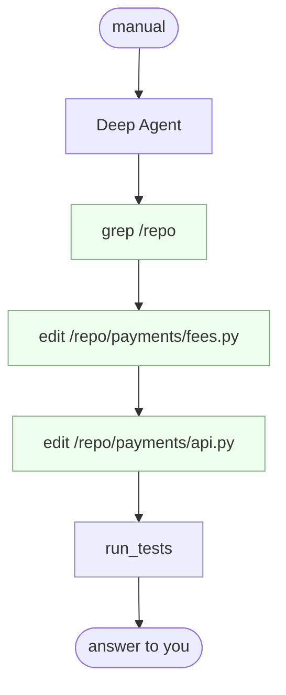

# 025. Rename a function across the repo

**When:** 10:30 (coding)  
**Trigger:** `manual`  
**Type:** refactor  
**Deep Agents features:** filesystem

grep-then-edit over real files, then run the tests.

## What you ask

> Rename calc_fee to compute_fee everywhere.

## Flow



## Tools

| Tool | What it does | Effect | Control |
|---|---|---|---|
| `run_tests` | Run the test suite. | read-only | - |

## Run it

```bash
python usecases/swe_day/025_rename_across_repo/usecase.py            # offline: scripted model, real Deep Agent
LC_MODEL=anthropic:claude-sonnet-4-6 python usecases/swe_day/025_rename_across_repo/usecase.py --live   # a real model makes the decisions
```

## Taking it to production

- You start this one yourself: a CLI command, a Slack slash command or an IDE action.
- Swap each `TOOL(..., returns=...)` for a real call (your API, a CLI, or an MCP server through `langchain-mcp-adapters`).
