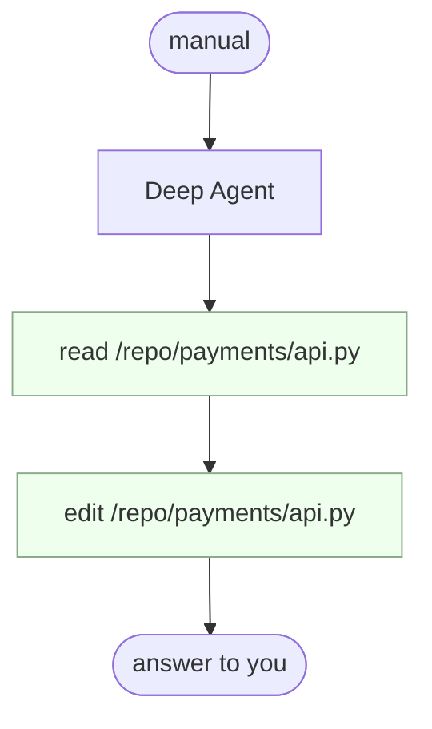

# 026. Add logging and metrics to an endpoint

**When:** 10:45 (coding)  
**Trigger:** `manual`  
**Type:** instrumentation  
**Deep Agents features:** AGENTS.md, filesystem

Mechanical but easy to get wrong; the team's conventions are in AGENTS.md.

## What you ask

> Add structured logging and a latency metric to create_payment.

## Flow



## Tools

| Tool | What it does | Effect | Control |
|---|---|---|---|
| (none) | Only the built-in Deep Agents file tools | - | - |

## House rules (AGENTS.md)

```markdown
# Observability rules
- Use log.info with event= and ids, never raw payloads
- Metric names: service_action_seconds
```

## Run it

```bash
python usecases/swe_day/026_add_observability/usecase.py            # offline: scripted model, real Deep Agent
LC_MODEL=anthropic:claude-sonnet-4-6 python usecases/swe_day/026_add_observability/usecase.py --live   # a real model makes the decisions
```

## Taking it to production

- You start this one yourself: a CLI command, a Slack slash command or an IDE action.
- Swap each `TOOL(..., returns=...)` for a real call (your API, a CLI, or an MCP server through `langchain-mcp-adapters`).
