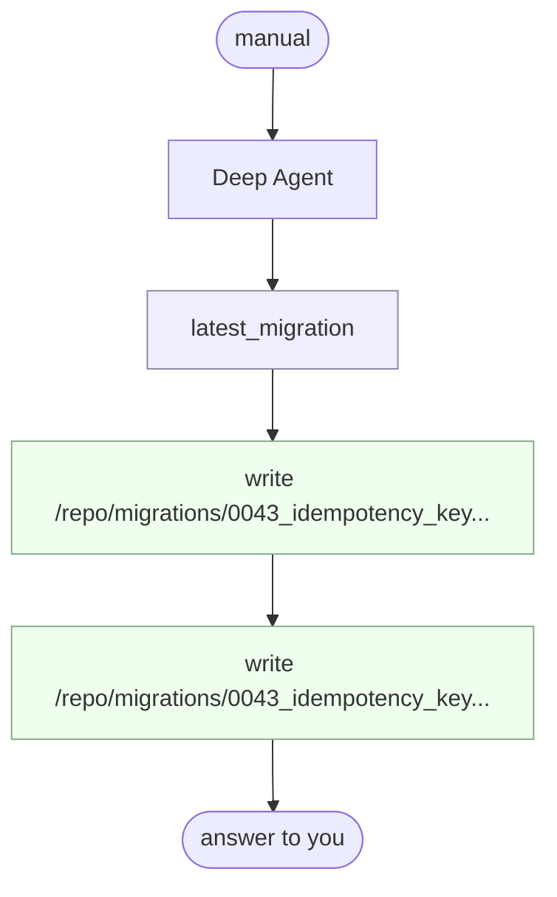

# 027. Generate a SQL migration with rollback

**When:** 11:00 (coding)  
**Trigger:** `manual`  
**Type:** migration  
**Deep Agents features:** filesystem

Every migration gets a matching down migration; applying to prod is not a tool it has.

## What you ask

> Write the migration for the idempotency_keys table.

## Flow



## Tools

| Tool | What it does | Effect | Control |
|---|---|---|---|
| `latest_migration` | Latest migration id. | read-only | - |

## Run it

```bash
python usecases/swe_day/027_sql_migration_with_rollback/usecase.py            # offline: scripted model, real Deep Agent
LC_MODEL=anthropic:claude-sonnet-4-6 python usecases/swe_day/027_sql_migration_with_rollback/usecase.py --live   # a real model makes the decisions
```

## Taking it to production

- You start this one yourself: a CLI command, a Slack slash command or an IDE action.
- Swap each `TOOL(..., returns=...)` for a real call (your API, a CLI, or an MCP server through `langchain-mcp-adapters`).
