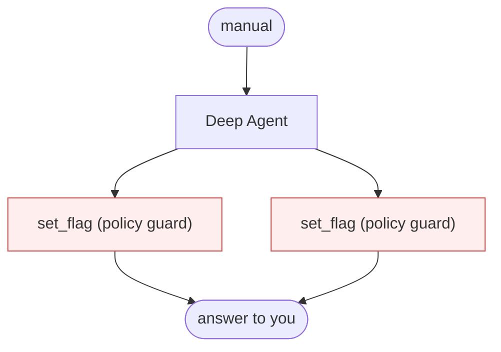

# 028. Feature flag setup

**When:** 11:15 (coding)  
**Trigger:** `manual`  
**Type:** config change  
**Deep Agents features:** guardrail, parallel calls

Staging flags are self-serve; turning anything on in prod is blocked by policy.

## What you ask

> Create the invoice_export flag, on in staging, off in prod.

## Flow



## Tools

| Tool | What it does | Effect | Control |
|---|---|---|---|
| `set_flag` | Set a feature flag in an environment. | changes state | policy guard |

## Run it

```bash
python usecases/swe_day/028_feature_flag_setup/usecase.py            # offline: scripted model, real Deep Agent
LC_MODEL=anthropic:claude-sonnet-4-6 python usecases/swe_day/028_feature_flag_setup/usecase.py --live   # a real model makes the decisions
```

## Taking it to production

- You start this one yourself: a CLI command, a Slack slash command or an IDE action.
- Keep the guard. It's ordinary Python in middleware, so it holds even when the model gets it wrong.
- Swap each `TOOL(..., returns=...)` for a real call (your API, a CLI, or an MCP server through `langchain-mcp-adapters`).
