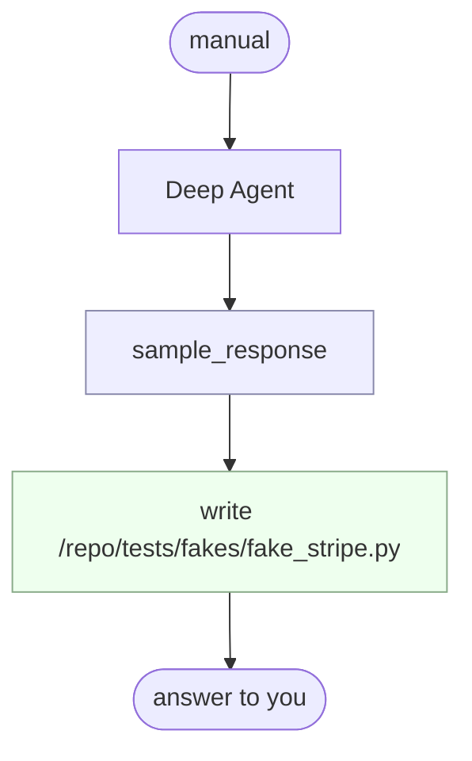

# 029. Mock an external API for tests

**When:** 11:25 (coding)  
**Trigger:** `manual`  
**Type:** test tooling  
**Deep Agents features:** filesystem

Captures real response shapes once, writes a fixture-backed fake.

## What you ask

> Create a fake Stripe client for our tests from the real API responses.

## Flow



## Tools

| Tool | What it does | Effect | Control |
|---|---|---|---|
| `sample_response` | A sample response from an external API. | read-only | - |

## Run it

```bash
python usecases/swe_day/029_mock_external_service/usecase.py            # offline: scripted model, real Deep Agent
LC_MODEL=anthropic:claude-sonnet-4-6 python usecases/swe_day/029_mock_external_service/usecase.py --live   # a real model makes the decisions
```

## Taking it to production

- You start this one yourself: a CLI command, a Slack slash command or an IDE action.
- Swap each `TOOL(..., returns=...)` for a real call (your API, a CLI, or an MCP server through `langchain-mcp-adapters`).
