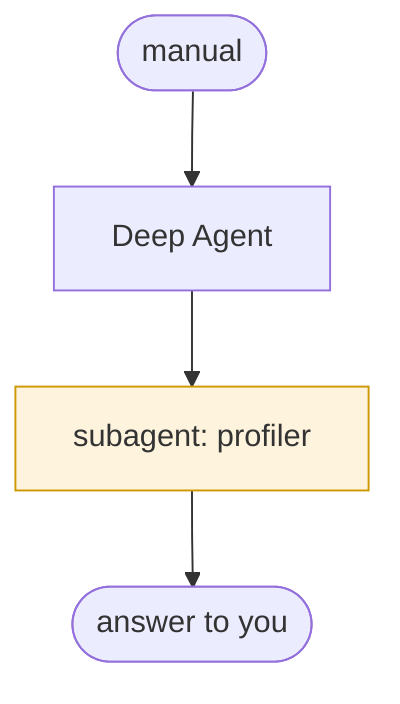

# 032. Find a performance hotspot

**When:** 11:55 (coding)  
**Trigger:** `manual`  
**Type:** performance  
**Deep Agents features:** subagents

A profiler subagent digs through traces; you get the one line that matters.

## What you ask

> Why is GET /invoices slow?

## Flow



## Tools

| Tool | What it does | Effect | Control |
|---|---|---|---|
| `trace_breakdown` | Span breakdown for an endpoint. | read-only | - |
| `slow_queries` | Slowest queries for an endpoint. | read-only | - |

## Subagents

- **profiler**: Analyzes traces and query plans. Tools: `trace_breakdown`, `slow_queries`.

## Run it

```bash
python usecases/swe_day/032_profile_hotspot/usecase.py            # offline: scripted model, real Deep Agent
LC_MODEL=anthropic:claude-sonnet-4-6 python usecases/swe_day/032_profile_hotspot/usecase.py --live   # a real model makes the decisions
```

## Taking it to production

- You start this one yourself: a CLI command, a Slack slash command or an IDE action.
- Subagents run in their own context window, which keeps the main thread small. Give them a cheaper model if the job is just reading.
- Swap each `TOOL(..., returns=...)` for a real call (your API, a CLI, or an MCP server through `langchain-mcp-adapters`).
