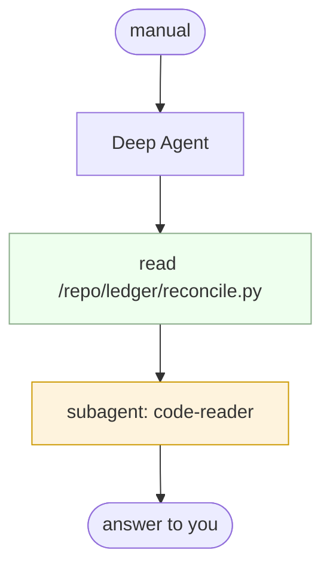

# 033. Explain legacy code before changing it

**When:** 12:05 (coding)  
**Trigger:** `manual`  
**Type:** code understanding  
**Deep Agents features:** subagents, filesystem

A reader subagent walks the file so the main agent can give a short, accurate explanation.

## What you ask

> What does reconcile_ledger() actually do?

## Flow



## Tools

| Tool | What it does | Effect | Control |
|---|---|---|---|
| (none) | Only the built-in Deep Agents file tools | - | - |

## Subagents

- **code-reader**: Reads and explains code. Tools: none.

## Run it

```bash
python usecases/swe_day/033_explain_legacy_code/usecase.py            # offline: scripted model, real Deep Agent
LC_MODEL=anthropic:claude-sonnet-4-6 python usecases/swe_day/033_explain_legacy_code/usecase.py --live   # a real model makes the decisions
```

## Taking it to production

- You start this one yourself: a CLI command, a Slack slash command or an IDE action.
- Subagents run in their own context window, which keeps the main thread small. Give them a cheaper model if the job is just reading.
- Swap each `TOOL(..., returns=...)` for a real call (your API, a CLI, or an MCP server through `langchain-mcp-adapters`).
