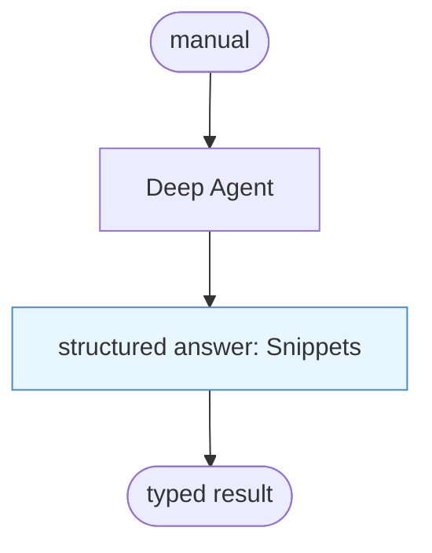

# 034. Cron and regex helper

**When:** 12:10 (coding)  
**Trigger:** `manual`  
**Type:** helper  
**Deep Agents features:** structured output

Small but error-prone; typed output you can paste.

## What you ask

> Cron for 'every weekday at 06:30 New York time', and a regex for invoice ids like INV-1038.

## Flow



## Tools

| Tool | What it does | Effect | Control |
|---|---|---|---|
| (none) | Only the built-in Deep Agents file tools | - | - |

## Run it

```bash
python usecases/swe_day/034_cron_and_regex_helper/usecase.py            # offline: scripted model, real Deep Agent
LC_MODEL=anthropic:claude-sonnet-4-6 python usecases/swe_day/034_cron_and_regex_helper/usecase.py --live   # a real model makes the decisions
```

## Taking it to production

- You start this one yourself: a CLI command, a Slack slash command or an IDE action.
- The `Snippets` result is a Pydantic object, so you can post it straight to a dashboard or database.
- Swap each `TOOL(..., returns=...)` for a real call (your API, a CLI, or an MCP server through `langchain-mcp-adapters`).
