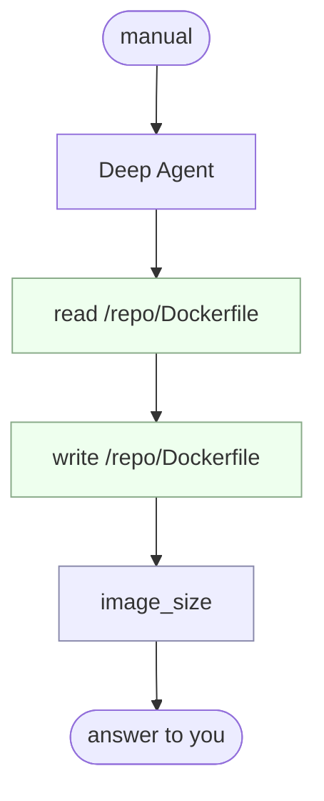

# 037. Dockerfile size and build-time optimization

**When:** 12:25 (coding)  
**Trigger:** `manual`  
**Type:** build  
**Deep Agents features:** filesystem

Reads the Dockerfile, rewrites it as a multi-stage build, checks size with a tool.

## What you ask

> Make the payments-api image smaller.

## Flow



## Tools

| Tool | What it does | Effect | Control |
|---|---|---|---|
| `image_size` | Build an image and report its size. | read-only | - |

## Run it

```bash
python usecases/swe_day/037_dockerfile_optimization/usecase.py            # offline: scripted model, real Deep Agent
LC_MODEL=anthropic:claude-sonnet-4-6 python usecases/swe_day/037_dockerfile_optimization/usecase.py --live   # a real model makes the decisions
```

## Taking it to production

- You start this one yourself: a CLI command, a Slack slash command or an IDE action.
- Swap each `TOOL(..., returns=...)` for a real call (your API, a CLI, or an MCP server through `langchain-mcp-adapters`).
