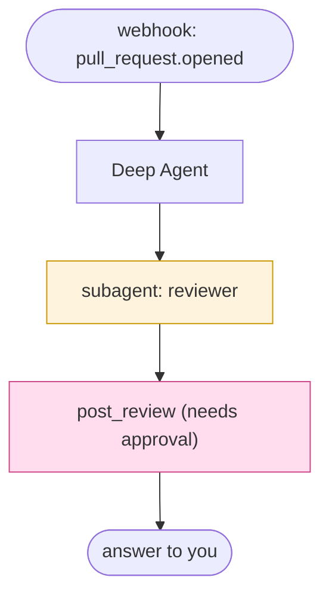

# 039. First-pass PR review

**When:** 12:30 (review)  
**Trigger:** `webhook: pull_request.opened`  
**Type:** code review  
**Deep Agents features:** subagents, HITL

A reviewer subagent reads the diff in its own context; posting the review is a write you approve.

## What you ask

> Review PR #812 and leave comments.

## Flow



## Tools

| Tool | What it does | Effect | Control |
|---|---|---|---|
| `get_diff` | Get a PR diff. | read-only | - |
| `post_review` | Post review comments to a PR. | sends something outside | human approval |

## Subagents

- **reviewer**: Reviews diffs for bugs and style. Tools: `get_diff`.

## Human decisions in the offline run

- `post_review`: approved

## Run it

```bash
python usecases/swe_day/039_pr_review_with_reviewer_subagent/usecase.py            # offline: scripted model, real Deep Agent
LC_MODEL=anthropic:claude-sonnet-4-6 python usecases/swe_day/039_pr_review_with_reviewer_subagent/usecase.py --live   # a real model makes the decisions
```

## Taking it to production

- Start it from the `pull_request.opened` webhook. A small FastAPI endpoint that calls `agent.invoke(...)` with a fresh `thread_id` per event is enough.
- Approvals: the run pauses on an interrupt. In production, send the pending action to Slack or a web UI and resume with `Command(resume={'decisions': [...]})` on the same `thread_id`. You need a persistent checkpointer (Postgres) for this.
- Subagents run in their own context window, which keeps the main thread small. Give them a cheaper model if the job is just reading.
- Swap each `TOOL(..., returns=...)` for a real call (your API, a CLI, or an MCP server through `langchain-mcp-adapters`).
