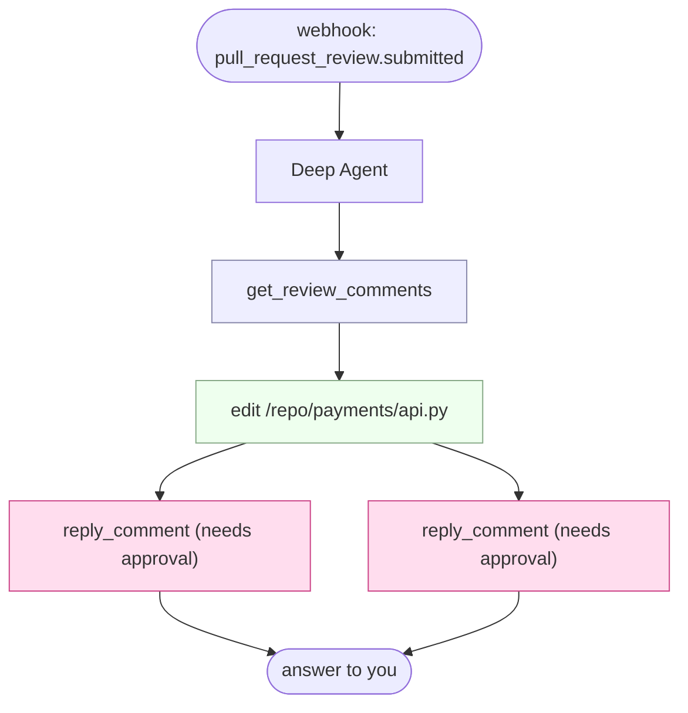

# 040. Address review comments on your PR

**When:** 12:40 (review)  
**Trigger:** `webhook: pull_request_review.submitted`  
**Type:** code review  
**Deep Agents features:** HITL, filesystem, parallel calls

Reads each comment, makes the code change, drafts the replies.

## What you ask

> Address the review comments on my PR #805.

## Flow



## Tools

| Tool | What it does | Effect | Control |
|---|---|---|---|
| `get_review_comments` | Review comments on a PR. | read-only | - |
| `reply_comment` | Reply to a review comment. | sends something outside | human approval |

## Human decisions in the offline run

- `reply_comment`: approved

## Run it

```bash
python usecases/swe_day/040_respond_to_review_comments/usecase.py            # offline: scripted model, real Deep Agent
LC_MODEL=anthropic:claude-sonnet-4-6 python usecases/swe_day/040_respond_to_review_comments/usecase.py --live   # a real model makes the decisions
```

## Taking it to production

- Start it from the `pull_request_review.submitted` webhook. A small FastAPI endpoint that calls `agent.invoke(...)` with a fresh `thread_id` per event is enough.
- Approvals: the run pauses on an interrupt. In production, send the pending action to Slack or a web UI and resume with `Command(resume={'decisions': [...]})` on the same `thread_id`. You need a persistent checkpointer (Postgres) for this.
- Swap each `TOOL(..., returns=...)` for a real call (your API, a CLI, or an MCP server through `langchain-mcp-adapters`).
