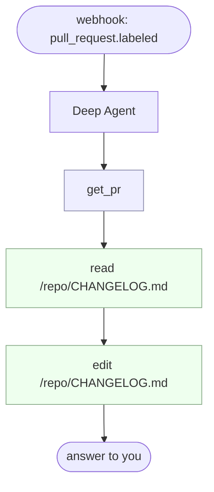

# 042. Changelog entry from a PR

**When:** 12:55 (review)  
**Trigger:** `webhook: pull_request.labeled`  
**Type:** docs  
**Deep Agents features:** filesystem

Keeps CHANGELOG.md in Keep-a-Changelog format without anyone thinking about it.

## What you ask

> Add a changelog entry for PR #812.

## Flow



## Tools

| Tool | What it does | Effect | Control |
|---|---|---|---|
| `get_pr` | PR metadata. | read-only | - |

## Run it

```bash
python usecases/swe_day/042_changelog_entry/usecase.py            # offline: scripted model, real Deep Agent
LC_MODEL=anthropic:claude-sonnet-4-6 python usecases/swe_day/042_changelog_entry/usecase.py --live   # a real model makes the decisions
```

## Taking it to production

- Start it from the `pull_request.labeled` webhook. A small FastAPI endpoint that calls `agent.invoke(...)` with a fresh `thread_id` per event is enough.
- Swap each `TOOL(..., returns=...)` for a real call (your API, a CLI, or an MCP server through `langchain-mcp-adapters`).
