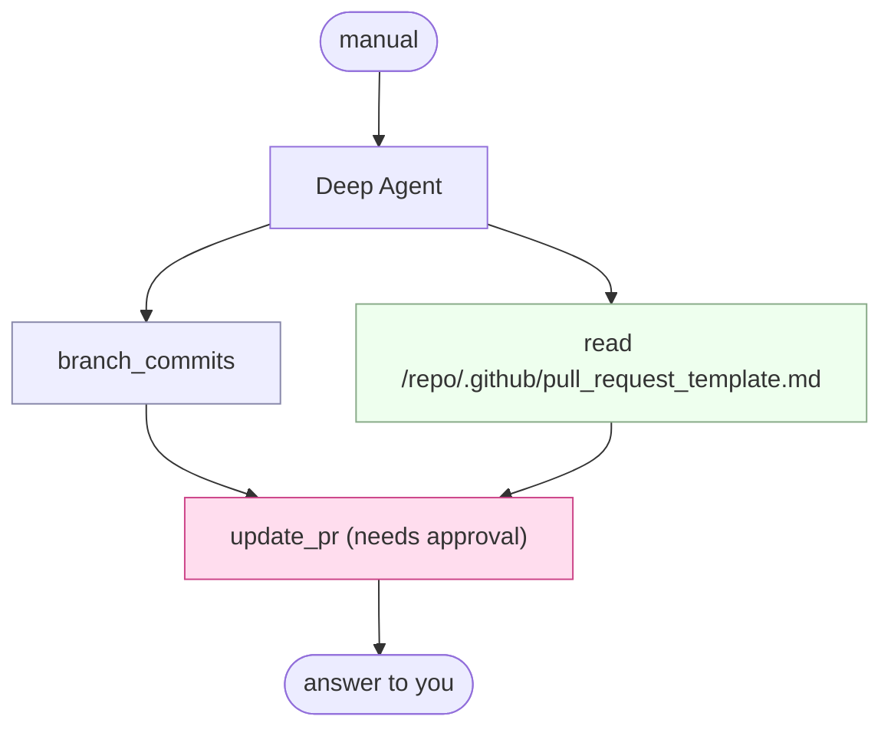

# 043. Write the PR description

**When:** 13:00 (review)  
**Trigger:** `manual`  
**Type:** docs  
**Deep Agents features:** HITL, filesystem, parallel calls

Builds the description from commits and the diff, in the repo's PR template.

## What you ask

> Write a PR description for my branch.

## Flow



## Tools

| Tool | What it does | Effect | Control |
|---|---|---|---|
| `branch_commits` | Commits on the current branch. | read-only | - |
| `update_pr` | Update a PR body. | sends something outside | human approval |

## Human decisions in the offline run

- `update_pr`: approved

## Run it

```bash
python usecases/swe_day/043_pr_description_writer/usecase.py            # offline: scripted model, real Deep Agent
LC_MODEL=anthropic:claude-sonnet-4-6 python usecases/swe_day/043_pr_description_writer/usecase.py --live   # a real model makes the decisions
```

## Taking it to production

- You start this one yourself: a CLI command, a Slack slash command or an IDE action.
- Approvals: the run pauses on an interrupt. In production, send the pending action to Slack or a web UI and resume with `Command(resume={'decisions': [...]})` on the same `thread_id`. You need a persistent checkpointer (Postgres) for this.
- Swap each `TOOL(..., returns=...)` for a real call (your API, a CLI, or an MCP server through `langchain-mcp-adapters`).
