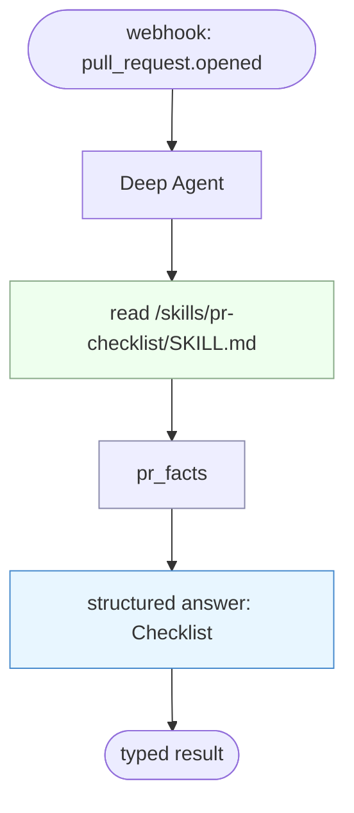

# 044. PR checklist check

**When:** 13:05 (review)  
**Trigger:** `webhook: pull_request.opened`  
**Type:** policy check  
**Deep Agents features:** skills, filesystem, structured output

The checklist lives in a skill, so changing the rules means editing one file.

## What you ask

> Does PR #820 meet our merge checklist?

## Flow



## Tools

| Tool | What it does | Effect | Control |
|---|---|---|---|
| `pr_facts` | Facts about a PR. | read-only | - |

## Skills

`/skills/pr-checklist/SKILL.md`: Use for merge readiness.

1. Tests changed
2. Migrations have down scripts
3. Docs updated for API changes

## Run it

```bash
python usecases/swe_day/044_pr_checklist_skill/usecase.py            # offline: scripted model, real Deep Agent
LC_MODEL=anthropic:claude-sonnet-4-6 python usecases/swe_day/044_pr_checklist_skill/usecase.py --live   # a real model makes the decisions
```

## Taking it to production

- Start it from the `pull_request.opened` webhook. A small FastAPI endpoint that calls `agent.invoke(...)` with a fresh `thread_id` per event is enough.
- The `Checklist` result is a Pydantic object, so you can post it straight to a dashboard or database.
- Swap each `TOOL(..., returns=...)` for a real call (your API, a CLI, or an MCP server through `langchain-mcp-adapters`).
