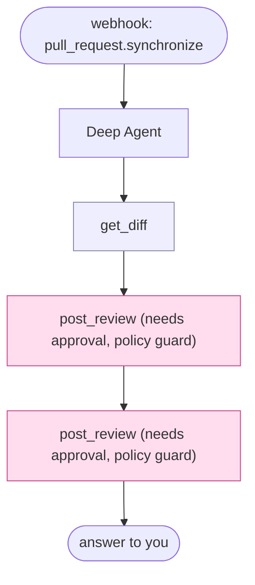

# 045. Security review of a diff

**When:** 13:10 (review)  
**Trigger:** `webhook: pull_request.synchronize`  
**Type:** security  
**Deep Agents features:** HITL, guardrail

Finds the hardcoded key; the guard stops any comment that would echo the secret back into GitHub.

## What you ask

> Security-check PR #821 before I post it.

## Flow



## Tools

| Tool | What it does | Effect | Control |
|---|---|---|---|
| `get_diff` | PR diff. | read-only | - |
| `post_review` | Post a review. | sends something outside | human approval, policy guard |

## Human decisions in the offline run

- `post_review`: approved

## Run it

```bash
python usecases/swe_day/045_security_review_of_diff/usecase.py            # offline: scripted model, real Deep Agent
LC_MODEL=anthropic:claude-sonnet-4-6 python usecases/swe_day/045_security_review_of_diff/usecase.py --live   # a real model makes the decisions
```

## Taking it to production

- Start it from the `pull_request.synchronize` webhook. A small FastAPI endpoint that calls `agent.invoke(...)` with a fresh `thread_id` per event is enough.
- Approvals: the run pauses on an interrupt. In production, send the pending action to Slack or a web UI and resume with `Command(resume={'decisions': [...]})` on the same `thread_id`. You need a persistent checkpointer (Postgres) for this.
- Keep the guard. It's ordinary Python in middleware, so it holds even when the model gets it wrong.
- Swap each `TOOL(..., returns=...)` for a real call (your API, a CLI, or an MCP server through `langchain-mcp-adapters`).
