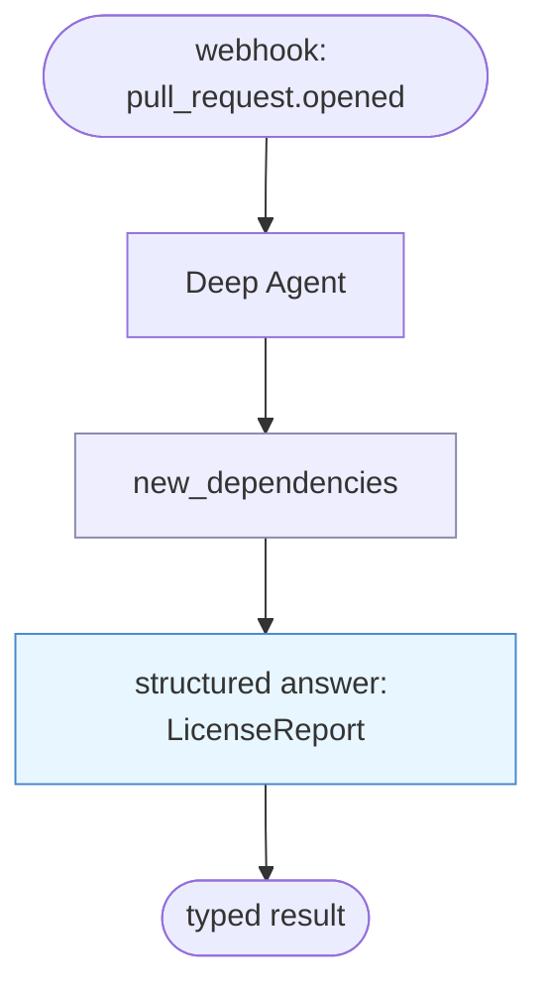

# 046. License check on new dependencies

**When:** 13:15 (review)  
**Trigger:** `webhook: pull_request.opened`  
**Type:** compliance  
**Deep Agents features:** AGENTS.md, structured output

Catches a GPL dependency before legal does.

## What you ask

> Do the new deps in PR #822 have acceptable licenses?

## Flow



## Tools

| Tool | What it does | Effect | Control |
|---|---|---|---|
| `new_dependencies` | Dependencies added in a PR. | read-only | - |

## House rules (AGENTS.md)

```markdown
# License policy
Allowed: MIT, BSD, Apache-2.0. Needs legal: GPL, AGPL, LGPL.
```

## Run it

```bash
python usecases/swe_day/046_dependency_license_check/usecase.py            # offline: scripted model, real Deep Agent
LC_MODEL=anthropic:claude-sonnet-4-6 python usecases/swe_day/046_dependency_license_check/usecase.py --live   # a real model makes the decisions
```

## Taking it to production

- Start it from the `pull_request.opened` webhook. A small FastAPI endpoint that calls `agent.invoke(...)` with a fresh `thread_id` per event is enough.
- The `LicenseReport` result is a Pydantic object, so you can post it straight to a dashboard or database.
- Swap each `TOOL(..., returns=...)` for a real call (your API, a CLI, or an MCP server through `langchain-mcp-adapters`).
