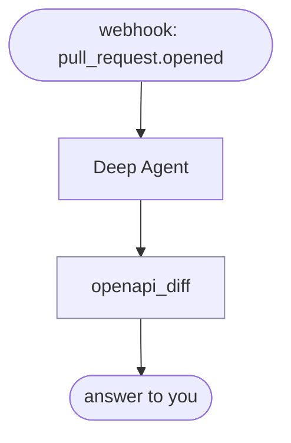

# 047. Breaking API change detector

**When:** 13:20 (review)  
**Trigger:** `webhook: pull_request.opened`  
**Type:** API governance  
**Deep Agents features:** 

Diffs the OpenAPI spec between main and the branch and names breaking changes.

## What you ask

> Does PR #823 break the public API?

## Flow



## Tools

| Tool | What it does | Effect | Control |
|---|---|---|---|
| `openapi_diff` | Diff two OpenAPI specs. | read-only | - |

## Run it

```bash
python usecases/swe_day/047_breaking_api_change_detector/usecase.py            # offline: scripted model, real Deep Agent
LC_MODEL=anthropic:claude-sonnet-4-6 python usecases/swe_day/047_breaking_api_change_detector/usecase.py --live   # a real model makes the decisions
```

## Taking it to production

- Start it from the `pull_request.opened` webhook. A small FastAPI endpoint that calls `agent.invoke(...)` with a fresh `thread_id` per event is enough.
- Swap each `TOOL(..., returns=...)` for a real call (your API, a CLI, or an MCP server through `langchain-mcp-adapters`).
