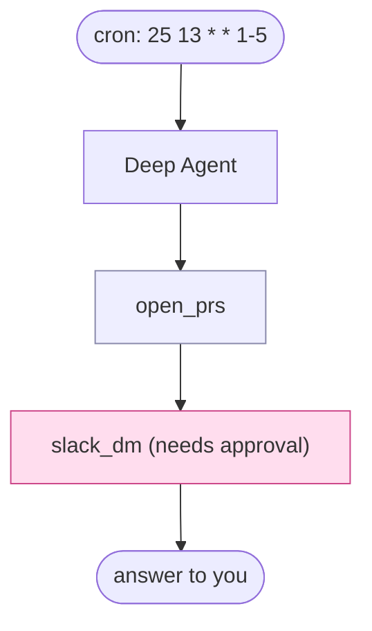

# 048. Stale PR nudger

**When:** 13:25 (review)  
**Trigger:** `cron: 25 13 * * 1-5`  
**Type:** reminders  
**Deep Agents features:** HITL

Runs after lunch so PRs don't rot. Messages go out after one approval.

## What you ask

> Nudge reviewers on PRs waiting more than 2 days.

## Flow



## Tools

| Tool | What it does | Effect | Control |
|---|---|---|---|
| `open_prs` | Open PRs with wait time. | read-only | - |
| `slack_dm` | DM someone on Slack. | sends something outside | human approval |

## Human decisions in the offline run

- `slack_dm`: approved

## Run it

```bash
python usecases/swe_day/048_stale_pr_nudger/usecase.py            # offline: scripted model, real Deep Agent
LC_MODEL=anthropic:claude-sonnet-4-6 python usecases/swe_day/048_stale_pr_nudger/usecase.py --live   # a real model makes the decisions
```

## Taking it to production

- Schedule it with `25 13 * * 1-5` (cron, server time; prefix `CRON_TZ=...` for your zone). A LangGraph Platform cron job, a GitHub Actions `schedule:`, or a Kubernetes CronJob all work.
- Approvals: the run pauses on an interrupt. In production, send the pending action to Slack or a web UI and resume with `Command(resume={'decisions': [...]})` on the same `thread_id`. You need a persistent checkpointer (Postgres) for this.
- Swap each `TOOL(..., returns=...)` for a real call (your API, a CLI, or an MCP server through `langchain-mcp-adapters`).
