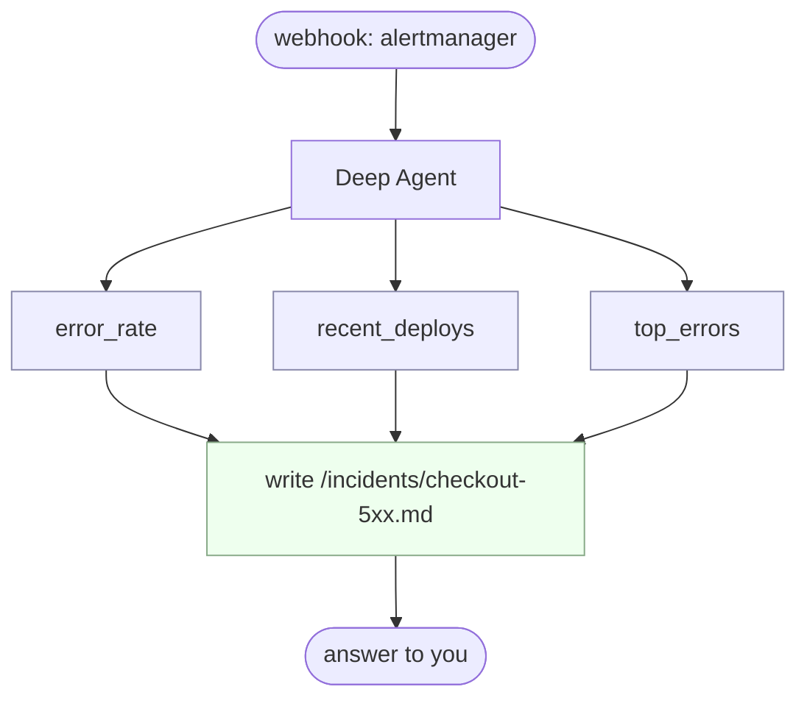

# 049. Alert to incident triage

**When:** 13:30 (ops)  
**Trigger:** `webhook: alertmanager`  
**Type:** incident response  
**Deep Agents features:** filesystem, parallel calls

Pulls metrics, logs and recent deploys in parallel; the triage note is written before a human joins.

## What you ask

> High 5xx on checkout. Triage.

## Flow



## Tools

| Tool | What it does | Effect | Control |
|---|---|---|---|
| `error_rate` | 5xx rate for a service. | read-only | - |
| `recent_deploys` | Deploys in the last N hours. | read-only | - |
| `top_errors` | Most common error lines. | read-only | - |

## Run it

```bash
python usecases/swe_day/049_alert_to_incident_triage/usecase.py            # offline: scripted model, real Deep Agent
LC_MODEL=anthropic:claude-sonnet-4-6 python usecases/swe_day/049_alert_to_incident_triage/usecase.py --live   # a real model makes the decisions
```

## Taking it to production

- Start it from the `alertmanager` webhook. A small FastAPI endpoint that calls `agent.invoke(...)` with a fresh `thread_id` per event is enough.
- Swap each `TOOL(..., returns=...)` for a real call (your API, a CLI, or an MCP server through `langchain-mcp-adapters`).
