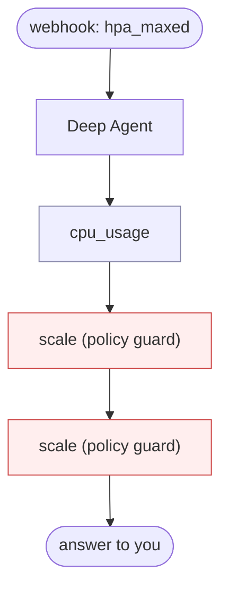

# 051. Scale a deployment

**When:** 13:50 (ops)  
**Trigger:** `webhook: hpa_maxed`  
**Type:** capacity  
**Deep Agents features:** guardrail

Scaling within the limit is allowed; going past the cost cap is blocked.

## What you ask

> payments-api is CPU bound. Scale it up.

## Flow



## Tools

| Tool | What it does | Effect | Control |
|---|---|---|---|
| `scale` | Set replica count. | changes state | policy guard |
| `cpu_usage` | CPU utilisation. | read-only | - |

## Run it

```bash
python usecases/swe_day/051_scale_deployment/usecase.py            # offline: scripted model, real Deep Agent
LC_MODEL=anthropic:claude-sonnet-4-6 python usecases/swe_day/051_scale_deployment/usecase.py --live   # a real model makes the decisions
```

## Taking it to production

- Start it from the `hpa_maxed` webhook. A small FastAPI endpoint that calls `agent.invoke(...)` with a fresh `thread_id` per event is enough.
- Keep the guard. It's ordinary Python in middleware, so it holds even when the model gets it wrong.
- Swap each `TOOL(..., returns=...)` for a real call (your API, a CLI, or an MCP server through `langchain-mcp-adapters`).
