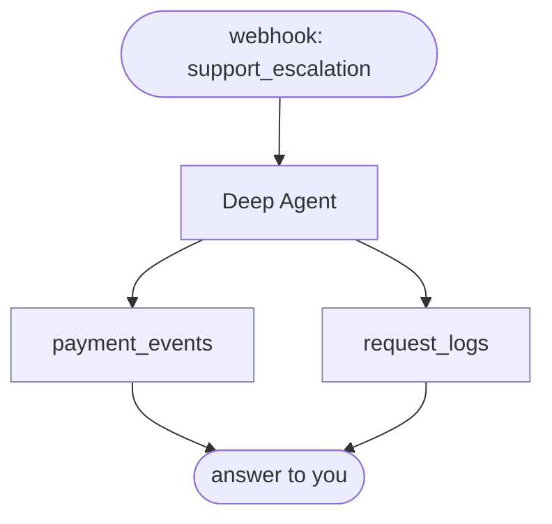

# 052. Customer escalation investigation

**When:** 14:00 (ops)  
**Trigger:** `webhook: support_escalation`  
**Type:** investigation  
**Deep Agents features:** parallel calls

Pulls the payment events and logs and writes up what actually happened for support.

## What you ask

> Customer says they were charged twice for order 99812. Investigate.

## Flow



## Tools

| Tool | What it does | Effect | Control |
|---|---|---|---|
| `payment_events` | Payment events for an order. | read-only | - |
| `request_logs` | Request logs for an order. | read-only | - |

## Run it

```bash
python usecases/swe_day/052_customer_escalation_investigation/usecase.py            # offline: scripted model, real Deep Agent
LC_MODEL=anthropic:claude-sonnet-4-6 python usecases/swe_day/052_customer_escalation_investigation/usecase.py --live   # a real model makes the decisions
```

## Taking it to production

- Start it from the `support_escalation` webhook. A small FastAPI endpoint that calls `agent.invoke(...)` with a fresh `thread_id` per event is enough.
- Swap each `TOOL(..., returns=...)` for a real call (your API, a CLI, or an MCP server through `langchain-mcp-adapters`).
