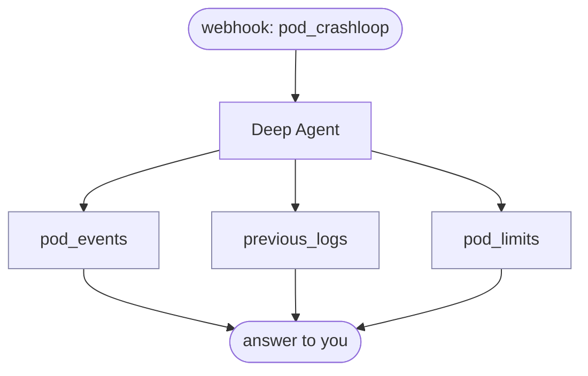

# 054. Kubernetes CrashLoopBackOff debug

**When:** 14:15 (ops)  
**Trigger:** `webhook: pod_crashloop`  
**Type:** troubleshooting  
**Deep Agents features:** parallel calls

Reads pod events and previous logs, finds the cause, suggests the fix.

## What you ask

> ledger-worker is in CrashLoopBackOff.

## Flow



## Tools

| Tool | What it does | Effect | Control |
|---|---|---|---|
| `pod_events` | kubectl describe events. | read-only | - |
| `previous_logs` | kubectl logs --previous. | read-only | - |
| `pod_limits` | Resource limits. | read-only | - |

## Run it

```bash
python usecases/swe_day/054_k8s_crashloop_debug/usecase.py            # offline: scripted model, real Deep Agent
LC_MODEL=anthropic:claude-sonnet-4-6 python usecases/swe_day/054_k8s_crashloop_debug/usecase.py --live   # a real model makes the decisions
```

## Taking it to production

- Start it from the `pod_crashloop` webhook. A small FastAPI endpoint that calls `agent.invoke(...)` with a fresh `thread_id` per event is enough.
- Swap each `TOOL(..., returns=...)` for a real call (your API, a CLI, or an MCP server through `langchain-mcp-adapters`).
