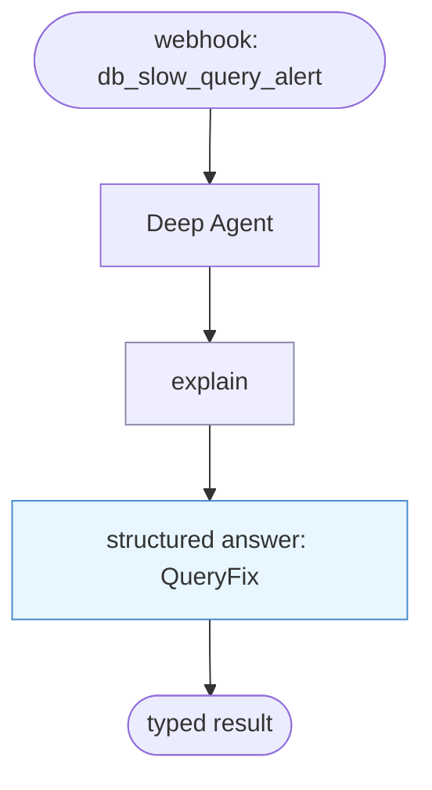

# 055. Slow query analysis

**When:** 14:25 (ops)  
**Trigger:** `webhook: db_slow_query_alert`  
**Type:** performance  
**Deep Agents features:** structured output

Runs EXPLAIN through a read-only tool and recommends an index.

## What you ask

> This query on invoices takes 4s. Why?

## Flow



## Tools

| Tool | What it does | Effect | Control |
|---|---|---|---|
| `explain` | EXPLAIN ANALYZE a query (read-only replica). | read-only | - |

## Run it

```bash
python usecases/swe_day/055_slow_query_analysis/usecase.py            # offline: scripted model, real Deep Agent
LC_MODEL=anthropic:claude-sonnet-4-6 python usecases/swe_day/055_slow_query_analysis/usecase.py --live   # a real model makes the decisions
```

## Taking it to production

- Start it from the `db_slow_query_alert` webhook. A small FastAPI endpoint that calls `agent.invoke(...)` with a fresh `thread_id` per event is enough.
- The `QueryFix` result is a Pydantic object, so you can post it straight to a dashboard or database.
- Swap each `TOOL(..., returns=...)` for a real call (your API, a CLI, or an MCP server through `langchain-mcp-adapters`).
