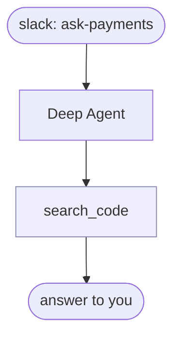

# 056. Answer a product question from the code

**When:** 14:35 (ops)  
**Trigger:** `slack: #ask-payments`  
**Type:** Q&A  
**Deep Agents features:** 

Answers from the actual code, with the file and line, not from what someone remembers.

## What you ask

> PM asks: do we retry failed webhooks, and how many times?

## Flow



## Tools

| Tool | What it does | Effect | Control |
|---|---|---|---|
| `search_code` | Search code. | read-only | - |

## Run it

```bash
python usecases/swe_day/056_answer_product_question_from_code/usecase.py            # offline: scripted model, real Deep Agent
LC_MODEL=anthropic:claude-sonnet-4-6 python usecases/swe_day/056_answer_product_question_from_code/usecase.py --live   # a real model makes the decisions
```

## Taking it to production

- Wire it to Slack (#ask-payments) with Slack Bolt; use the Slack thread id as the LangGraph `thread_id`.
- Swap each `TOOL(..., returns=...)` for a real call (your API, a CLI, or an MCP server through `langchain-mcp-adapters`).
