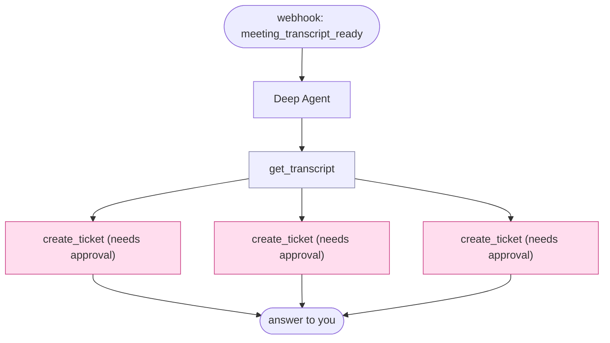

# 057. Meeting notes to tickets

**When:** 14:45 (ops)  
**Trigger:** `webhook: meeting_transcript_ready`  
**Type:** ticket creation  
**Deep Agents features:** HITL, parallel calls

Pulls the action items out and creates tickets; one isn't a real task and gets rejected.

## What you ask

> Turn the architecture sync transcript into tickets.

## Flow



## Tools

| Tool | What it does | Effect | Control |
|---|---|---|---|
| `get_transcript` | Meeting transcript. | read-only | - |
| `create_ticket` | Create a ticket. | changes state | human approval |

## Human decisions in the offline run

- `create_ticket`: call 1: approved; call 2: approved; call 3: rejected

## Run it

```bash
python usecases/swe_day/057_meeting_notes_to_tickets/usecase.py            # offline: scripted model, real Deep Agent
LC_MODEL=anthropic:claude-sonnet-4-6 python usecases/swe_day/057_meeting_notes_to_tickets/usecase.py --live   # a real model makes the decisions
```

## Taking it to production

- Start it from the `meeting_transcript_ready` webhook. A small FastAPI endpoint that calls `agent.invoke(...)` with a fresh `thread_id` per event is enough.
- Approvals: the run pauses on an interrupt. In production, send the pending action to Slack or a web UI and resume with `Command(resume={'decisions': [...]})` on the same `thread_id`. You need a persistent checkpointer (Postgres) for this.
- Swap each `TOOL(..., returns=...)` for a real call (your API, a CLI, or an MCP server through `langchain-mcp-adapters`).
