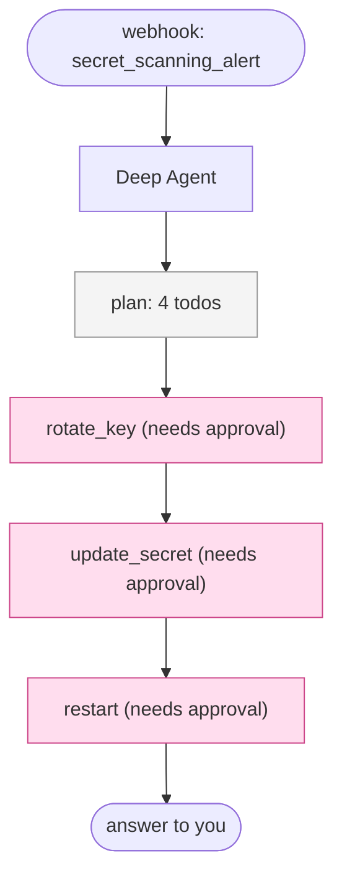

# 058. Rotate a leaked secret

**When:** 14:55 (ops)  
**Trigger:** `webhook: secret_scanning_alert`  
**Type:** security  
**Deep Agents features:** HITL, todos

Rotation and redeploys touch prod and each needs approval. The agent follows the runbook order.

## What you ask

> GitHub flagged a leaked Stripe key. Rotate it.

## Flow



## Tools

| Tool | What it does | Effect | Control |
|---|---|---|---|
| `rotate_key` | Rotate an API key at the provider. | changes state | human approval |
| `update_secret` | Update the secret in the secret manager. | changes state | human approval |
| `restart` | Rolling restart of a deployment. | changes state | human approval |

## Human decisions in the offline run

- `rotate_key`: approved
- `update_secret`: approved
- `restart`: approved

## Run it

```bash
python usecases/swe_day/058_rotate_leaked_secret/usecase.py            # offline: scripted model, real Deep Agent
LC_MODEL=anthropic:claude-sonnet-4-6 python usecases/swe_day/058_rotate_leaked_secret/usecase.py --live   # a real model makes the decisions
```

## Taking it to production

- Start it from the `secret_scanning_alert` webhook. A small FastAPI endpoint that calls `agent.invoke(...)` with a fresh `thread_id` per event is enough.
- Approvals: the run pauses on an interrupt. In production, send the pending action to Slack or a web UI and resume with `Command(resume={'decisions': [...]})` on the same `thread_id`. You need a persistent checkpointer (Postgres) for this.
- Swap each `TOOL(..., returns=...)` for a real call (your API, a CLI, or an MCP server through `langchain-mcp-adapters`).
