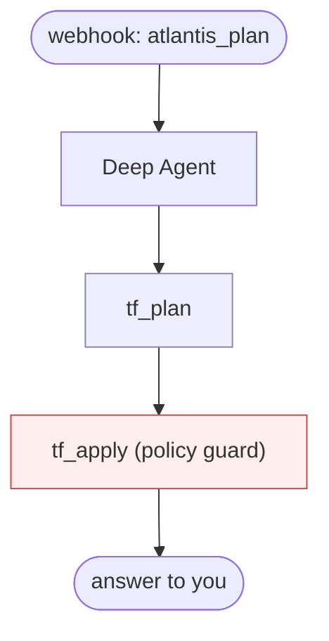

# 059. Terraform plan review

**When:** 15:05 (ops)  
**Trigger:** `webhook: atlantis_plan`  
**Type:** infra review  
**Deep Agents features:** guardrail

Applies are blocked whenever the plan destroys a stateful resource.

## What you ask

> Review the Terraform plan for the payments VPC change and apply if safe.

## Flow



## Tools

| Tool | What it does | Effect | Control |
|---|---|---|---|
| `tf_plan` | Terraform plan summary. | read-only | - |
| `tf_apply` | Terraform apply. | changes state | policy guard |

## Run it

```bash
python usecases/swe_day/059_terraform_plan_review/usecase.py            # offline: scripted model, real Deep Agent
LC_MODEL=anthropic:claude-sonnet-4-6 python usecases/swe_day/059_terraform_plan_review/usecase.py --live   # a real model makes the decisions
```

## Taking it to production

- Start it from the `atlantis_plan` webhook. A small FastAPI endpoint that calls `agent.invoke(...)` with a fresh `thread_id` per event is enough.
- Keep the guard. It's ordinary Python in middleware, so it holds even when the model gets it wrong.
- Swap each `TOOL(..., returns=...)` for a real call (your API, a CLI, or an MCP server through `langchain-mcp-adapters`).
