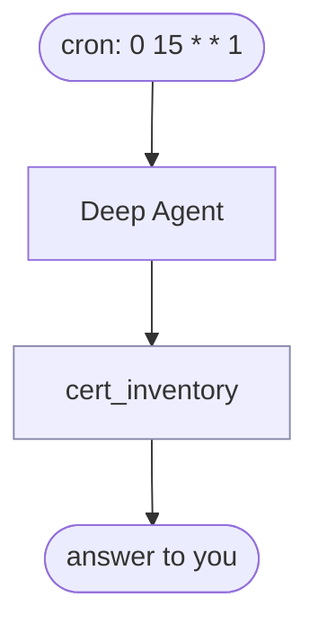

# 060. TLS certificate expiry check

**When:** 15:15 (ops)  
**Trigger:** `cron: 0 15 * * 1`  
**Type:** monitoring  
**Deep Agents features:** 

Weekly; boring until the week it saves an outage.

## What you ask

> Any certs expiring in the next 30 days?

## Flow



## Tools

| Tool | What it does | Effect | Control |
|---|---|---|---|
| `cert_inventory` | All certs and days to expiry. | read-only | - |

## Run it

```bash
python usecases/swe_day/060_cert_expiry_check/usecase.py            # offline: scripted model, real Deep Agent
LC_MODEL=anthropic:claude-sonnet-4-6 python usecases/swe_day/060_cert_expiry_check/usecase.py --live   # a real model makes the decisions
```

## Taking it to production

- Schedule it with `0 15 * * 1` (cron, server time; prefix `CRON_TZ=...` for your zone). A LangGraph Platform cron job, a GitHub Actions `schedule:`, or a Kubernetes CronJob all work.
- Swap each `TOOL(..., returns=...)` for a real call (your API, a CLI, or an MCP server through `langchain-mcp-adapters`).
