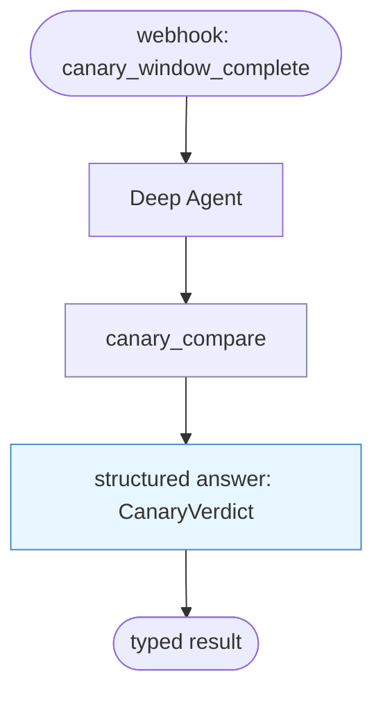

# 061. Canary go / no-go

**When:** 15:25 (ops)  
**Trigger:** `webhook: canary_window_complete`  
**Type:** deploy decision  
**Deep Agents features:** AGENTS.md, structured output

Compares canary and baseline metrics against fixed thresholds and returns a typed verdict.

## What you ask

> Is the ledger v3.2 canary good to promote?

## Flow



## Tools

| Tool | What it does | Effect | Control |
|---|---|---|---|
| `canary_compare` | Canary vs baseline metrics. | read-only | - |

## House rules (AGENTS.md)

```markdown
# Canary rules
No-go if error rate > 1.5x baseline or p99 > 1.2x baseline.
```

## Run it

```bash
python usecases/swe_day/061_canary_go_no_go/usecase.py            # offline: scripted model, real Deep Agent
LC_MODEL=anthropic:claude-sonnet-4-6 python usecases/swe_day/061_canary_go_no_go/usecase.py --live   # a real model makes the decisions
```

## Taking it to production

- Start it from the `canary_window_complete` webhook. A small FastAPI endpoint that calls `agent.invoke(...)` with a fresh `thread_id` per event is enough.
- The `CanaryVerdict` result is a Pydantic object, so you can post it straight to a dashboard or database.
- Swap each `TOOL(..., returns=...)` for a real call (your API, a CLI, or an MCP server through `langchain-mcp-adapters`).
