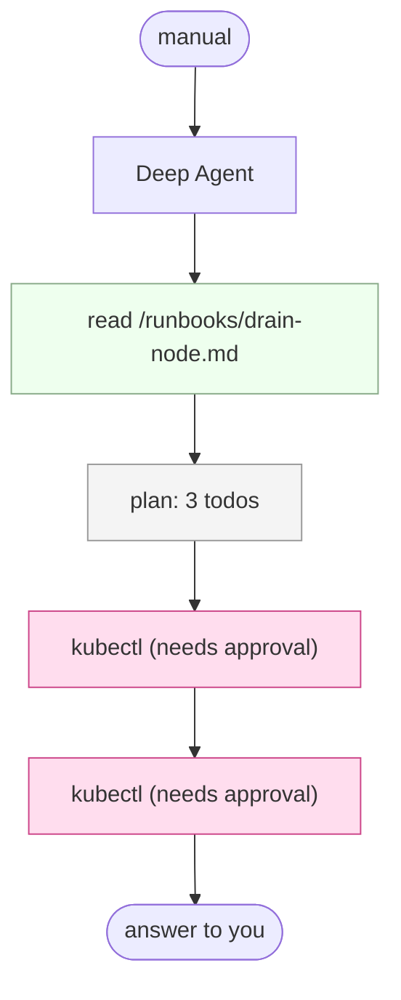

# 062. Follow a runbook step by step

**When:** 15:35 (ops)  
**Trigger:** `manual`  
**Type:** runbook  
**Deep Agents features:** HITL, todos, filesystem

Reads the runbook and runs it as a todo list; the cordon/drain steps need approval.

## What you ask

> Run the 'drain a node' runbook for node ip-10-0-3-7.

## Flow



## Tools

| Tool | What it does | Effect | Control |
|---|---|---|---|
| `kubectl` | Run a kubectl command. | changes state | human approval |

## Human decisions in the offline run

- `kubectl`: approved

## Run it

```bash
python usecases/swe_day/062_runbook_execution/usecase.py            # offline: scripted model, real Deep Agent
LC_MODEL=anthropic:claude-sonnet-4-6 python usecases/swe_day/062_runbook_execution/usecase.py --live   # a real model makes the decisions
```

## Taking it to production

- You start this one yourself: a CLI command, a Slack slash command or an IDE action.
- Approvals: the run pauses on an interrupt. In production, send the pending action to Slack or a web UI and resume with `Command(resume={'decisions': [...]})` on the same `thread_id`. You need a persistent checkpointer (Postgres) for this.
- Swap each `TOOL(..., returns=...)` for a real call (your API, a CLI, or an MCP server through `langchain-mcp-adapters`).
