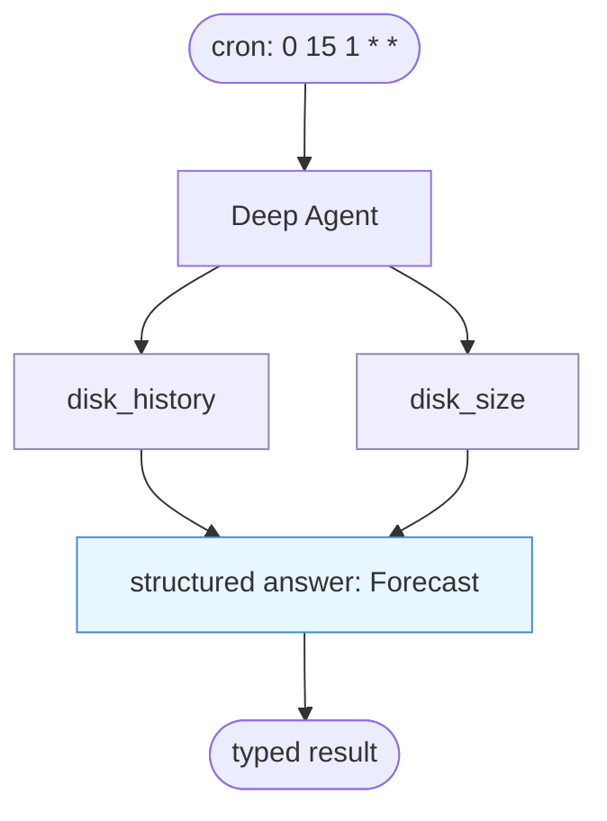

# 063. Capacity planning forecast

**When:** 15:40 (ops)  
**Trigger:** `cron: 0 15 1 * *`  
**Type:** forecasting  
**Deep Agents features:** parallel calls, structured output

Monthly; fits a trend to real usage and gives a date.

## What you ask

> When will the ledger DB run out of disk?

## Flow



## Tools

| Tool | What it does | Effect | Control |
|---|---|---|---|
| `disk_history` | Disk usage history (GB per month). | read-only | - |
| `disk_size` | Disk size in GB. | read-only | - |

## Run it

```bash
python usecases/swe_day/063_capacity_planning/usecase.py            # offline: scripted model, real Deep Agent
LC_MODEL=anthropic:claude-sonnet-4-6 python usecases/swe_day/063_capacity_planning/usecase.py --live   # a real model makes the decisions
```

## Taking it to production

- Schedule it with `0 15 1 * *` (cron, server time; prefix `CRON_TZ=...` for your zone). A LangGraph Platform cron job, a GitHub Actions `schedule:`, or a Kubernetes CronJob all work.
- The `Forecast` result is a Pydantic object, so you can post it straight to a dashboard or database.
- Swap each `TOOL(..., returns=...)` for a real call (your API, a CLI, or an MCP server through `langchain-mcp-adapters`).
