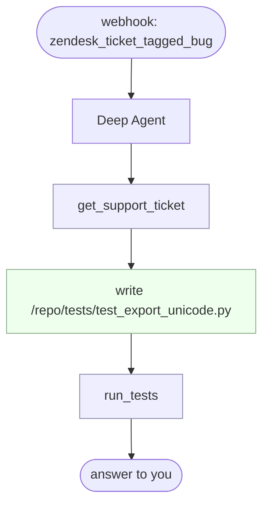

# 064. Reproduce a bug from a support ticket

**When:** 15:45 (ops)  
**Trigger:** `webhook: zendesk_ticket_tagged_bug`  
**Type:** bug repro  
**Deep Agents features:** filesystem

Writes a failing test that reproduces the report; the fix comes after.

## What you ask

> Support says invoices with emoji in the name fail to export. Reproduce it.

## Flow



## Tools

| Tool | What it does | Effect | Control |
|---|---|---|---|
| `get_support_ticket` | Support ticket. | read-only | - |
| `run_tests` | Run tests. | read-only | - |

## Run it

```bash
python usecases/swe_day/064_support_ticket_reproduction/usecase.py            # offline: scripted model, real Deep Agent
LC_MODEL=anthropic:claude-sonnet-4-6 python usecases/swe_day/064_support_ticket_reproduction/usecase.py --live   # a real model makes the decisions
```

## Taking it to production

- Start it from the `zendesk_ticket_tagged_bug` webhook. A small FastAPI endpoint that calls `agent.invoke(...)` with a fresh `thread_id` per event is enough.
- Swap each `TOOL(..., returns=...)` for a real call (your API, a CLI, or an MCP server through `langchain-mcp-adapters`).
