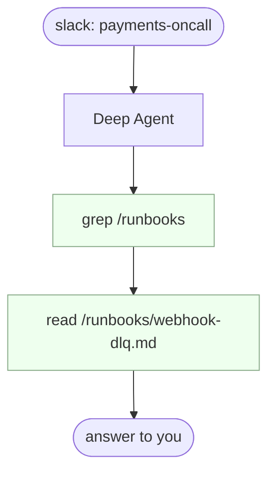

# 065. On-call Q&A from runbooks

**When:** 15:50 (ops)  
**Trigger:** `slack: #payments-oncall`  
**Type:** Q&A  
**Deep Agents features:** filesystem

Answers from the team's runbooks, not from memory, so on-call answers stay consistent.

## What you ask

> How do I replay dead-lettered webhooks?

## Flow



## Tools

| Tool | What it does | Effect | Control |
|---|---|---|---|
| (none) | Only the built-in Deep Agents file tools | - | - |

## Run it

```bash
python usecases/swe_day/065_oncall_question_from_runbooks/usecase.py            # offline: scripted model, real Deep Agent
LC_MODEL=anthropic:claude-sonnet-4-6 python usecases/swe_day/065_oncall_question_from_runbooks/usecase.py --live   # a real model makes the decisions
```

## Taking it to production

- Wire it to Slack (#payments-oncall) with Slack Bolt; use the Slack thread id as the LangGraph `thread_id`.
- Swap each `TOOL(..., returns=...)` for a real call (your API, a CLI, or an MCP server through `langchain-mcp-adapters`).
