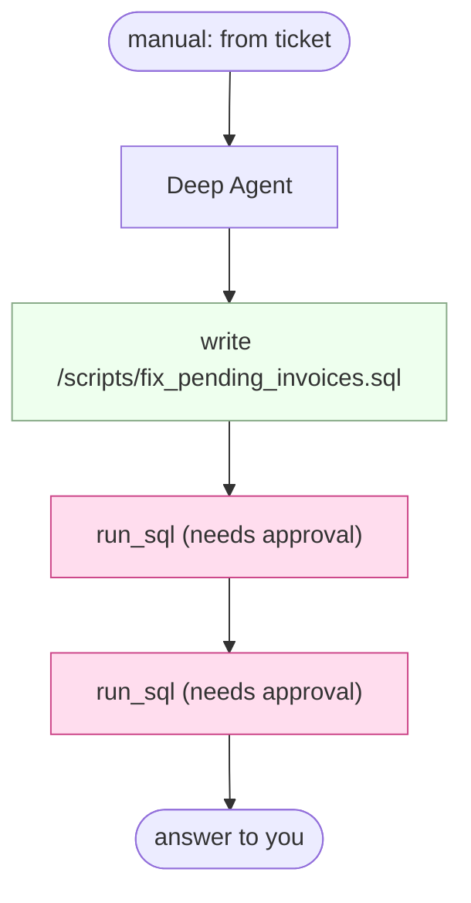

# 066. One-off data fix script

**When:** 15:55 (ops)  
**Trigger:** `manual: from ticket`  
**Type:** data fix  
**Deep Agents features:** HITL, filesystem

Writes the script with a dry run first. The real run changes prod data, so it needs approval.

## What you ask

> Fix the 37 invoices stuck in 'pending' after yesterday's outage.

## Flow



## Tools

| Tool | What it does | Effect | Control |
|---|---|---|---|
| `run_sql` | Run SQL against prod. | changes state | human approval |

## Human decisions in the offline run

- `run_sql`: call 1: approved; call 2: approved

## Run it

```bash
python usecases/swe_day/066_data_fix_script/usecase.py            # offline: scripted model, real Deep Agent
LC_MODEL=anthropic:claude-sonnet-4-6 python usecases/swe_day/066_data_fix_script/usecase.py --live   # a real model makes the decisions
```

## Taking it to production

- You start this one yourself: a CLI command, a Slack slash command or an IDE action.
- Approvals: the run pauses on an interrupt. In production, send the pending action to Slack or a web UI and resume with `Command(resume={'decisions': [...]})` on the same `thread_id`. You need a persistent checkpointer (Postgres) for this.
- Swap each `TOOL(..., returns=...)` for a real call (your API, a CLI, or an MCP server through `langchain-mcp-adapters`).
