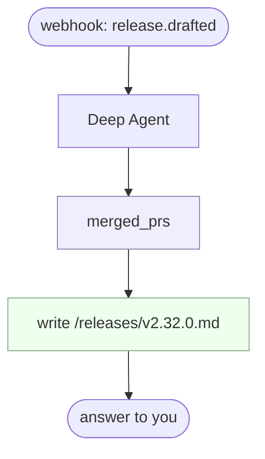

# 067. Release notes from merged PRs

**When:** 16:00 (release)  
**Trigger:** `webhook: release.drafted`  
**Type:** docs  
**Deep Agents features:** filesystem

Groups merged PRs by label and writes notes that people actually read.

## What you ask

> Write release notes for payments-api v2.32.0.

## Flow



## Tools

| Tool | What it does | Effect | Control |
|---|---|---|---|
| `merged_prs` | PRs merged since the last tag. | read-only | - |

## Run it

```bash
python usecases/swe_day/067_release_notes_from_merged_prs/usecase.py            # offline: scripted model, real Deep Agent
LC_MODEL=anthropic:claude-sonnet-4-6 python usecases/swe_day/067_release_notes_from_merged_prs/usecase.py --live   # a real model makes the decisions
```

## Taking it to production

- Start it from the `release.drafted` webhook. A small FastAPI endpoint that calls `agent.invoke(...)` with a fresh `thread_id` per event is enough.
- Swap each `TOOL(..., returns=...)` for a real call (your API, a CLI, or an MCP server through `langchain-mcp-adapters`).
