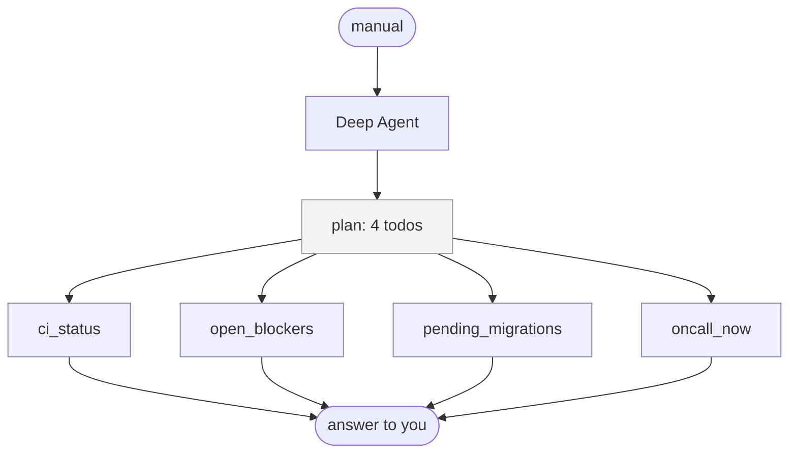

# 068. Release readiness checklist

**When:** 16:10 (release)  
**Trigger:** `manual`  
**Type:** release gate  
**Deep Agents features:** todos, parallel calls

Checks CI, migrations, open blockers and on-call coverage in parallel, tracked as todos.

## What you ask

> Is v2.32.0 ready to ship?

## Flow



## Tools

| Tool | What it does | Effect | Control |
|---|---|---|---|
| `ci_status` | CI status for a ref. | read-only | - |
| `open_blockers` | Open release blockers. | read-only | - |
| `pending_migrations` | Migrations in the release. | read-only | - |
| `oncall_now` | Who is on call. | read-only | - |

## Run it

```bash
python usecases/swe_day/068_release_readiness_checklist/usecase.py            # offline: scripted model, real Deep Agent
LC_MODEL=anthropic:claude-sonnet-4-6 python usecases/swe_day/068_release_readiness_checklist/usecase.py --live   # a real model makes the decisions
```

## Taking it to production

- You start this one yourself: a CLI command, a Slack slash command or an IDE action.
- Swap each `TOOL(..., returns=...)` for a real call (your API, a CLI, or an MCP server through `langchain-mcp-adapters`).
