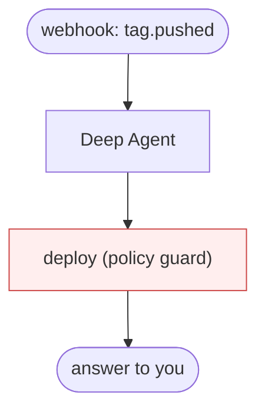

# 069. Deploy to staging

**When:** 16:20 (release)  
**Trigger:** `webhook: tag.pushed`  
**Type:** deploy  
**Deep Agents features:** guardrail

Staging deploys are self-serve; the guard stops the agent pointing the same tool at prod.

## What you ask

> Deploy v2.32.0 to staging.

## Flow



## Tools

| Tool | What it does | Effect | Control |
|---|---|---|---|
| `deploy` | Deploy a version to an environment. | changes state | policy guard |

## Run it

```bash
python usecases/swe_day/069_deploy_to_staging/usecase.py            # offline: scripted model, real Deep Agent
LC_MODEL=anthropic:claude-sonnet-4-6 python usecases/swe_day/069_deploy_to_staging/usecase.py --live   # a real model makes the decisions
```

## Taking it to production

- Start it from the `tag.pushed` webhook. A small FastAPI endpoint that calls `agent.invoke(...)` with a fresh `thread_id` per event is enough.
- Keep the guard. It's ordinary Python in middleware, so it holds even when the model gets it wrong.
- Swap each `TOOL(..., returns=...)` for a real call (your API, a CLI, or an MCP server through `langchain-mcp-adapters`).
