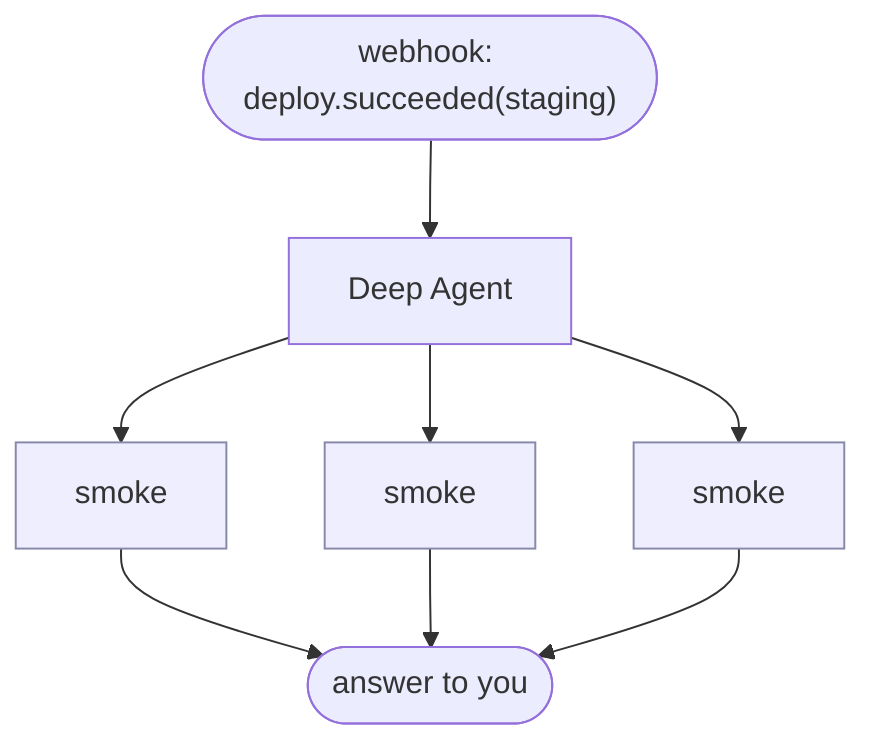

# 070. Smoke tests on staging

**When:** 16:30 (release)  
**Trigger:** `webhook: deploy.succeeded(staging)`  
**Type:** testing  
**Deep Agents features:** parallel calls

Runs the suites in parallel and reports only what matters.

## What you ask

> Run smoke tests against staging.

## Flow



## Tools

| Tool | What it does | Effect | Control |
|---|---|---|---|
| `smoke` | Run a smoke suite. | read-only | - |

## Run it

```bash
python usecases/swe_day/070_staging_smoke_tests/usecase.py            # offline: scripted model, real Deep Agent
LC_MODEL=anthropic:claude-sonnet-4-6 python usecases/swe_day/070_staging_smoke_tests/usecase.py --live   # a real model makes the decisions
```

## Taking it to production

- Start it from the `deploy.succeeded(staging)` webhook. A small FastAPI endpoint that calls `agent.invoke(...)` with a fresh `thread_id` per event is enough.
- Swap each `TOOL(..., returns=...)` for a real call (your API, a CLI, or an MCP server through `langchain-mcp-adapters`).
