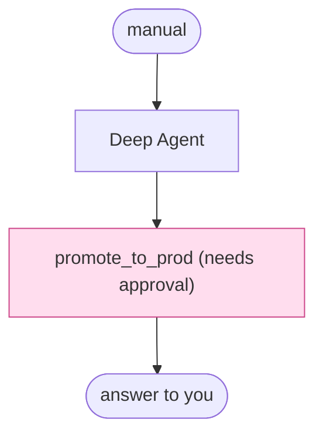

# 071. Promote to production

**When:** 16:45 (release)  
**Trigger:** `manual`  
**Type:** deploy  
**Deep Agents features:** HITL

The one step that always needs a human.

## What you ask

> Promote v2.32.0 to prod as a 10% canary.

## Flow



## Tools

| Tool | What it does | Effect | Control |
|---|---|---|---|
| `promote_to_prod` | Start a prod canary. | touches prod / money | human approval |

## Human decisions in the offline run

- `promote_to_prod`: approved

## Run it

```bash
python usecases/swe_day/071_promote_to_production/usecase.py            # offline: scripted model, real Deep Agent
LC_MODEL=anthropic:claude-sonnet-4-6 python usecases/swe_day/071_promote_to_production/usecase.py --live   # a real model makes the decisions
```

## Taking it to production

- You start this one yourself: a CLI command, a Slack slash command or an IDE action.
- Approvals: the run pauses on an interrupt. In production, send the pending action to Slack or a web UI and resume with `Command(resume={'decisions': [...]})` on the same `thread_id`. You need a persistent checkpointer (Postgres) for this.
- Swap each `TOOL(..., returns=...)` for a real call (your API, a CLI, or an MCP server through `langchain-mcp-adapters`).
