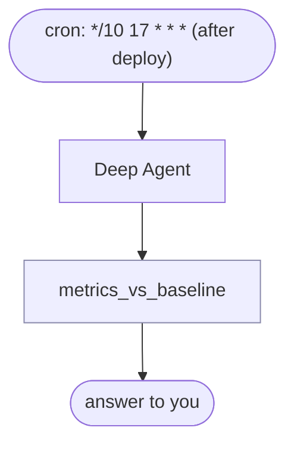

# 072. Post-deploy watch

**When:** 17:00 (release)  
**Trigger:** `cron: */10 17 * * * (after deploy)`  
**Type:** monitoring  
**Deep Agents features:** 

Compares key metrics to the pre-deploy baseline and only speaks up if something moved.

## What you ask

> Watch payments-api for 30 minutes after the deploy.

## Flow



## Tools

| Tool | What it does | Effect | Control |
|---|---|---|---|
| `metrics_vs_baseline` | Metrics compared to baseline. | read-only | - |

## Run it

```bash
python usecases/swe_day/072_post_deploy_monitoring/usecase.py            # offline: scripted model, real Deep Agent
LC_MODEL=anthropic:claude-sonnet-4-6 python usecases/swe_day/072_post_deploy_monitoring/usecase.py --live   # a real model makes the decisions
```

## Taking it to production

- Schedule it with `*/10 17 * * * (after deploy)` (cron, server time; prefix `CRON_TZ=...` for your zone). A LangGraph Platform cron job, a GitHub Actions `schedule:`, or a Kubernetes CronJob all work.
- Swap each `TOOL(..., returns=...)` for a real call (your API, a CLI, or an MCP server through `langchain-mcp-adapters`).
