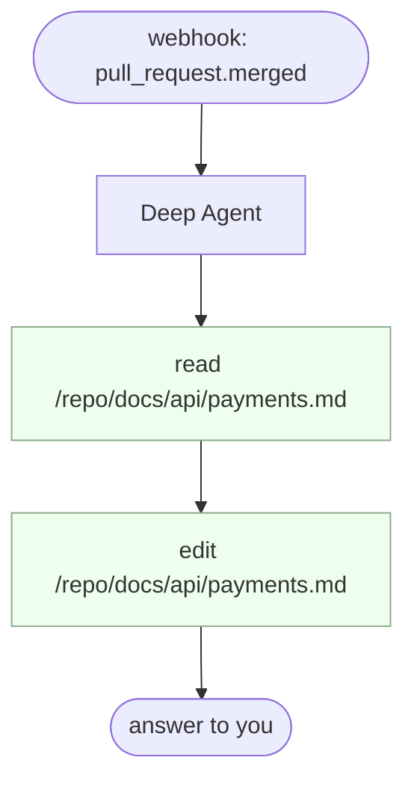

# 073. Update docs after an API change

**When:** 17:10 (release)  
**Trigger:** `webhook: pull_request.merged`  
**Type:** docs  
**Deep Agents features:** filesystem

Edits the real docs file so docs ship with the code.

## What you ask

> Update the API docs for the new Idempotency-Key header.

## Flow



## Tools

| Tool | What it does | Effect | Control |
|---|---|---|---|
| (none) | Only the built-in Deep Agents file tools | - | - |

## Run it

```bash
python usecases/swe_day/073_docs_update_after_change/usecase.py            # offline: scripted model, real Deep Agent
LC_MODEL=anthropic:claude-sonnet-4-6 python usecases/swe_day/073_docs_update_after_change/usecase.py --live   # a real model makes the decisions
```

## Taking it to production

- Start it from the `pull_request.merged` webhook. A small FastAPI endpoint that calls `agent.invoke(...)` with a fresh `thread_id` per event is enough.
- Swap each `TOOL(..., returns=...)` for a real call (your API, a CLI, or an MCP server through `langchain-mcp-adapters`).
