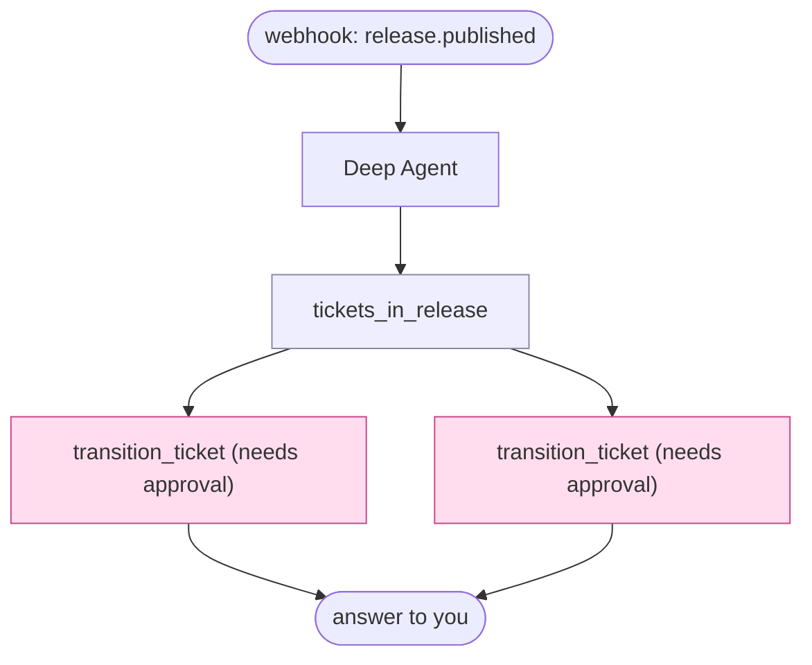

# 074. Close tickets that shipped

**When:** 17:20 (release)  
**Trigger:** `webhook: release.published`  
**Type:** ticket hygiene  
**Deep Agents features:** HITL, parallel calls

Moving tickets is a write; done in one approved batch.

## What you ask

> Close the Jira tickets included in v2.32.0.

## Flow



## Tools

| Tool | What it does | Effect | Control |
|---|---|---|---|
| `tickets_in_release` | Tickets linked to a release. | read-only | - |
| `transition_ticket` | Move a ticket to a status. | changes state | human approval |

## Human decisions in the offline run

- `transition_ticket`: approved

## Run it

```bash
python usecases/swe_day/074_close_shipped_tickets/usecase.py            # offline: scripted model, real Deep Agent
LC_MODEL=anthropic:claude-sonnet-4-6 python usecases/swe_day/074_close_shipped_tickets/usecase.py --live   # a real model makes the decisions
```

## Taking it to production

- Start it from the `release.published` webhook. A small FastAPI endpoint that calls `agent.invoke(...)` with a fresh `thread_id` per event is enough.
- Approvals: the run pauses on an interrupt. In production, send the pending action to Slack or a web UI and resume with `Command(resume={'decisions': [...]})` on the same `thread_id`. You need a persistent checkpointer (Postgres) for this.
- Swap each `TOOL(..., returns=...)` for a real call (your API, a CLI, or an MCP server through `langchain-mcp-adapters`).
