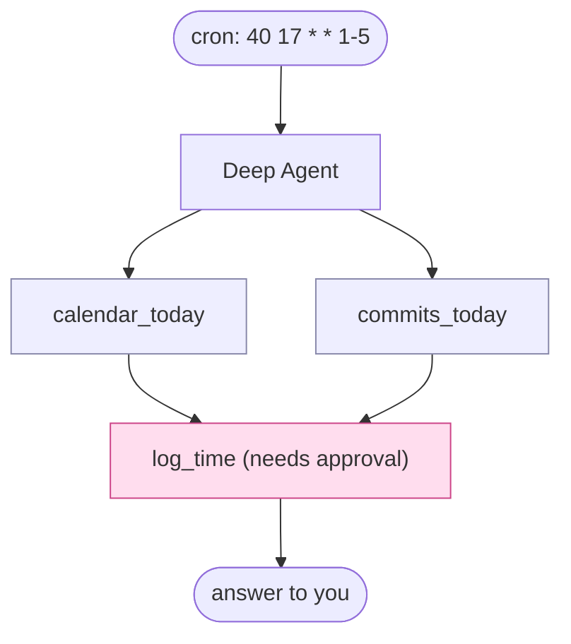

# 076. Fill in the time log

**When:** 17:40 (release)  
**Trigger:** `cron: 40 17 * * 1-5`  
**Type:** admin  
**Deep Agents features:** HITL, parallel calls

Nobody likes timesheets; this one is built from calendar and commits.

## What you ask

> Fill my time log for today.

## Flow



## Tools

| Tool | What it does | Effect | Control |
|---|---|---|---|
| `calendar_today` | Today's meetings. | read-only | - |
| `commits_today` | Commits today by ticket. | read-only | - |
| `log_time` | Log time entries. | changes state | human approval |

## Human decisions in the offline run

- `log_time`: approved

## Run it

```bash
python usecases/swe_day/076_time_log_entry/usecase.py            # offline: scripted model, real Deep Agent
LC_MODEL=anthropic:claude-sonnet-4-6 python usecases/swe_day/076_time_log_entry/usecase.py --live   # a real model makes the decisions
```

## Taking it to production

- Schedule it with `40 17 * * 1-5` (cron, server time; prefix `CRON_TZ=...` for your zone). A LangGraph Platform cron job, a GitHub Actions `schedule:`, or a Kubernetes CronJob all work.
- Approvals: the run pauses on an interrupt. In production, send the pending action to Slack or a web UI and resume with `Command(resume={'decisions': [...]})` on the same `thread_id`. You need a persistent checkpointer (Postgres) for this.
- Swap each `TOOL(..., returns=...)` for a real call (your API, a CLI, or an MCP server through `langchain-mcp-adapters`).
