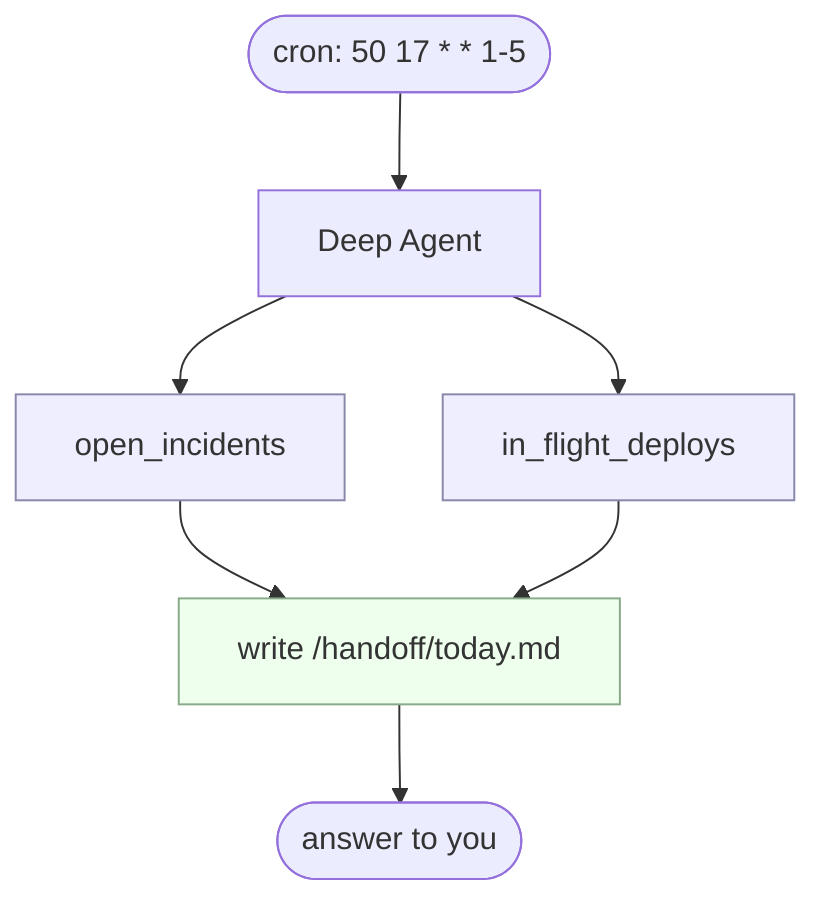

# 077. Handoff note for the other timezone

**When:** 17:50 (release)  
**Trigger:** `cron: 50 17 * * 1-5`  
**Type:** handoff  
**Deep Agents features:** filesystem, parallel calls

So the morning team in another timezone doesn't start by asking what happened.

## What you ask

> Write the handoff for the Bangalore team.

## Flow



## Tools

| Tool | What it does | Effect | Control |
|---|---|---|---|
| `open_incidents` | Open incidents. | read-only | - |
| `in_flight_deploys` | Deploys in progress. | read-only | - |

## Run it

```bash
python usecases/swe_day/077_timezone_handoff_note/usecase.py            # offline: scripted model, real Deep Agent
LC_MODEL=anthropic:claude-sonnet-4-6 python usecases/swe_day/077_timezone_handoff_note/usecase.py --live   # a real model makes the decisions
```

## Taking it to production

- Schedule it with `50 17 * * 1-5` (cron, server time; prefix `CRON_TZ=...` for your zone). A LangGraph Platform cron job, a GitHub Actions `schedule:`, or a Kubernetes CronJob all work.
- Swap each `TOOL(..., returns=...)` for a real call (your API, a CLI, or an MCP server through `langchain-mcp-adapters`).
