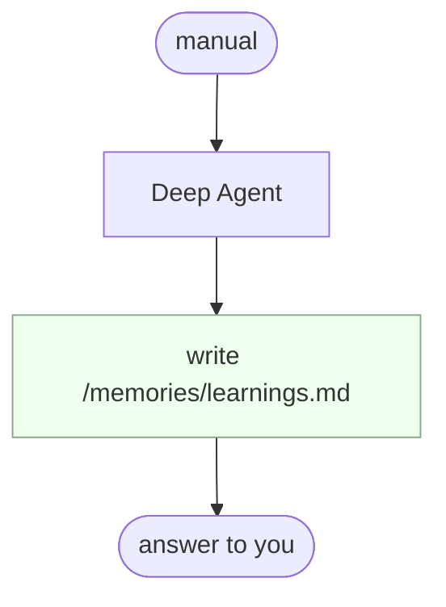

# 080. Save today's learnings

**When:** 18:20 (release)  
**Trigger:** `manual`  
**Type:** knowledge  
**Deep Agents features:** long-term memory, filesystem

Writes to /memories/, which persists across threads, so the incident agent knows next time.

## What you ask

> Remember: pricing config KeyError means the currency map is missing; rollback, then fix config.

## Flow



## Tools

| Tool | What it does | Effect | Control |
|---|---|---|---|
| (none) | Only the built-in Deep Agents file tools | - | - |

## Run it

```bash
python usecases/swe_day/080_save_learnings/usecase.py            # offline: scripted model, real Deep Agent
LC_MODEL=anthropic:claude-sonnet-4-6 python usecases/swe_day/080_save_learnings/usecase.py --live   # a real model makes the decisions
```

## Taking it to production

- You start this one yourself: a CLI command, a Slack slash command or an IDE action.
- `/memories/` maps to a LangGraph store. Use `PostgresStore` so the next run (or tomorrow's) can read it.
- Swap each `TOOL(..., returns=...)` for a real call (your API, a CLI, or an MCP server through `langchain-mcp-adapters`).
