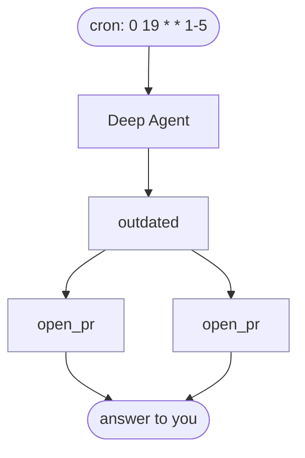

# 081. Nightly dependency update PRs

**When:** 19:00 (night)  
**Trigger:** `cron: 0 19 * * 1-5`  
**Type:** maintenance  
**Deep Agents features:** parallel calls

Runs unattended. Opening a PR is allowed; merging isn't a tool it has.

## What you ask

> Open PRs for safe dependency updates.

## Flow



## Tools

| Tool | What it does | Effect | Control |
|---|---|---|---|
| `outdated` | Outdated packages. | read-only | - |
| `open_pr` | Open a PR. | sends something outside | - |

## Run it

```bash
python usecases/swe_day/081_nightly_dependency_update_prs/usecase.py            # offline: scripted model, real Deep Agent
LC_MODEL=anthropic:claude-sonnet-4-6 python usecases/swe_day/081_nightly_dependency_update_prs/usecase.py --live   # a real model makes the decisions
```

## Taking it to production

- Schedule it with `0 19 * * 1-5` (cron, server time; prefix `CRON_TZ=...` for your zone). A LangGraph Platform cron job, a GitHub Actions `schedule:`, or a Kubernetes CronJob all work.
- Swap each `TOOL(..., returns=...)` for a real call (your API, a CLI, or an MCP server through `langchain-mcp-adapters`).
