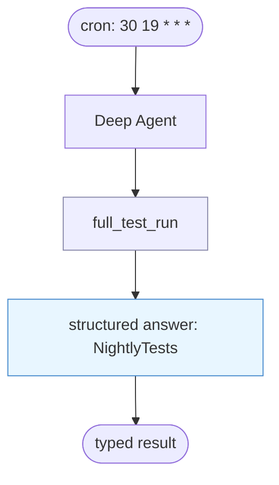

# 082. Nightly full test run and coverage

**When:** 19:30 (night)  
**Trigger:** `cron: 30 19 * * *`  
**Type:** testing  
**Deep Agents features:** structured output

Catches slow coverage drift that per-PR checks miss.

## What you ask

> Run the full suite and report coverage changes.

## Flow



## Tools

| Tool | What it does | Effect | Control |
|---|---|---|---|
| `full_test_run` | Full test suite with coverage. | read-only | - |

## Run it

```bash
python usecases/swe_day/082_nightly_test_and_coverage/usecase.py            # offline: scripted model, real Deep Agent
LC_MODEL=anthropic:claude-sonnet-4-6 python usecases/swe_day/082_nightly_test_and_coverage/usecase.py --live   # a real model makes the decisions
```

## Taking it to production

- Schedule it with `30 19 * * *` (cron, server time; prefix `CRON_TZ=...` for your zone). A LangGraph Platform cron job, a GitHub Actions `schedule:`, or a Kubernetes CronJob all work.
- The `NightlyTests` result is a Pydantic object, so you can post it straight to a dashboard or database.
- Swap each `TOOL(..., returns=...)` for a real call (your API, a CLI, or an MCP server through `langchain-mcp-adapters`).
