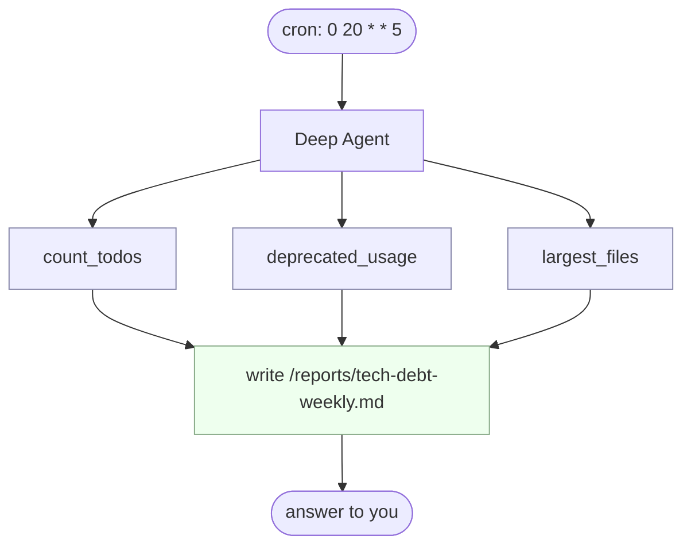

# 083. Weekly tech-debt report

**When:** 20:00 (night)  
**Trigger:** `cron: 0 20 * * 5`  
**Type:** reporting  
**Deep Agents features:** filesystem, parallel calls

Counts TODOs, deprecated calls and big files; writes a report the team skims on Monday.

## What you ask

> Build the weekly tech-debt report.

## Flow



## Tools

| Tool | What it does | Effect | Control |
|---|---|---|---|
| `count_todos` | TODO/FIXME count by dir. | read-only | - |
| `deprecated_usage` | Deprecated API usages. | read-only | - |
| `largest_files` | Largest source files. | read-only | - |

## Run it

```bash
python usecases/swe_day/083_weekly_tech_debt_report/usecase.py            # offline: scripted model, real Deep Agent
LC_MODEL=anthropic:claude-sonnet-4-6 python usecases/swe_day/083_weekly_tech_debt_report/usecase.py --live   # a real model makes the decisions
```

## Taking it to production

- Schedule it with `0 20 * * 5` (cron, server time; prefix `CRON_TZ=...` for your zone). A LangGraph Platform cron job, a GitHub Actions `schedule:`, or a Kubernetes CronJob all work.
- Swap each `TOOL(..., returns=...)` for a real call (your API, a CLI, or an MCP server through `langchain-mcp-adapters`).
