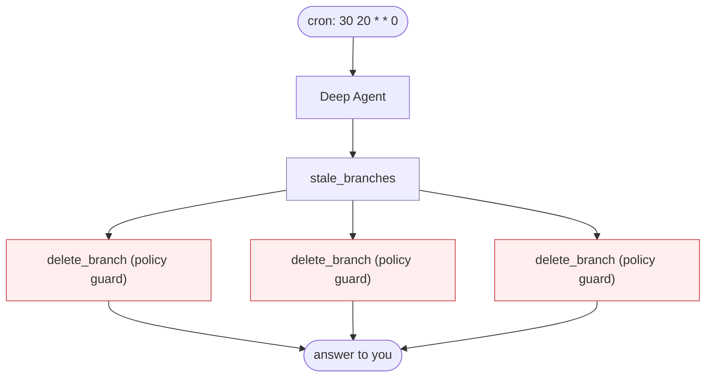

# 084. Stale branch cleanup

**When:** 20:30 (night)  
**Trigger:** `cron: 30 20 * * 0`  
**Type:** repo hygiene  
**Deep Agents features:** guardrail, parallel calls

Runs weekly. Protected branches are blocked by policy no matter what the model decides.

## What you ask

> Delete merged branches older than 30 days.

## Flow



## Tools

| Tool | What it does | Effect | Control |
|---|---|---|---|
| `stale_branches` | Merged branches older than N days. | read-only | - |
| `delete_branch` | Delete a remote branch. | changes state | policy guard |

## Run it

```bash
python usecases/swe_day/084_stale_branch_cleanup/usecase.py            # offline: scripted model, real Deep Agent
LC_MODEL=anthropic:claude-sonnet-4-6 python usecases/swe_day/084_stale_branch_cleanup/usecase.py --live   # a real model makes the decisions
```

## Taking it to production

- Schedule it with `30 20 * * 0` (cron, server time; prefix `CRON_TZ=...` for your zone). A LangGraph Platform cron job, a GitHub Actions `schedule:`, or a Kubernetes CronJob all work.
- Keep the guard. It's ordinary Python in middleware, so it holds even when the model gets it wrong.
- Swap each `TOOL(..., returns=...)` for a real call (your API, a CLI, or an MCP server through `langchain-mcp-adapters`).
