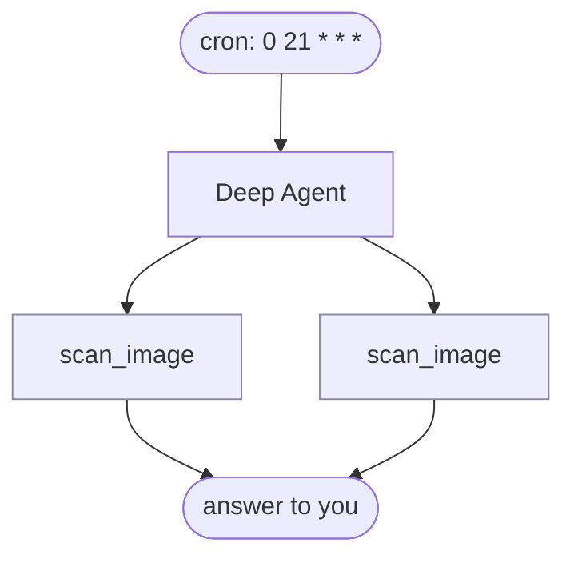

# 085. Container image vulnerability scan

**When:** 21:00 (night)  
**Trigger:** `cron: 0 21 * * *`  
**Type:** security  
**Deep Agents features:** parallel calls

Scans every image and only reports criticals with a fix available.

## What you ask

> Scan our production images for critical CVEs.

## Flow



## Tools

| Tool | What it does | Effect | Control |
|---|---|---|---|
| `scan_image` | Scan an image for CVEs. | read-only | - |

## Run it

```bash
python usecases/swe_day/085_container_vulnerability_scan/usecase.py            # offline: scripted model, real Deep Agent
LC_MODEL=anthropic:claude-sonnet-4-6 python usecases/swe_day/085_container_vulnerability_scan/usecase.py --live   # a real model makes the decisions
```

## Taking it to production

- Schedule it with `0 21 * * *` (cron, server time; prefix `CRON_TZ=...` for your zone). A LangGraph Platform cron job, a GitHub Actions `schedule:`, or a Kubernetes CronJob all work.
- Swap each `TOOL(..., returns=...)` for a real call (your API, a CLI, or an MCP server through `langchain-mcp-adapters`).
